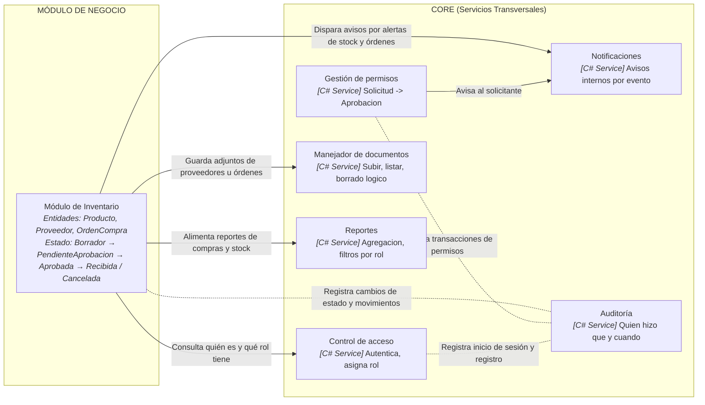

# ProyectoFinalProg3_Inventary
# Descripcion del proyecto
Este es el repositorio oficial del proyecto final de programación 3 basado en un sistema de inventario para un negocio pequeño desarrollado por Richard Hernández.

## Diagrama de componentes hecho en mermaid



### 4 Entidades base y relaciones
Cree las siguientes clases a continuacion:

1. **DetalleOrden** — Atributos: `Id`, `Cantidad`, `Precio`, `Subtotal`. Relaciones: `OrdenCompra` y `Producto`.
2. **OrdenCompra** — Atributos: `Id`, `FechaCreacion`, `Total`, `CreadoPorUsuarioId`, `ProveedorId`. Relaciones: `Proveedor` y `Detalles`.
3. **Producto** — Atributos: `Id`, `Nombre`, `Codigo`, `Precio`, `StockActual`, `StockMinimo`, `ProveedorId`. Relaciones: `Proveedor` y `DetallesOrden`.
4. **Proveedor** — Atributos: `Id`, `Nombre`, `Cedula`, `Telefono`, `Email`. Relaciones: `Productos` y `OrdenesCompra`.

#### Bitacora con el Agente - Punto 3
Crítica de la bitácora con el agente.

Le pedí que criticara el diagrama de componentes de acuerdo a las seis señales y me confirmó lo que supuse, la frontera de la dependencia Core- Negocio es unidireccional y correcta, pero me señaló que el componente Reportes no tenía conexiones en el diagrama visual, por lo que este agregó la relación de alimentación de reportes.

Error puntual que noté:
El agente me dio el diagrama corregido pero cometió un error, en la parte de los componentes del core no estaba el mensaje característico que decía de que se encargaba cada componente. tuve que corregirlo finalmente.

## Requisitos previos
- .NET SDK 10.0
- SQL Server (LocalDB o Express)
- EF Core CLI para aplicar las migraciones: `dotnet tool install --global dotnet-ef`
- Gmail con contraseña de aplicación (para el envío de correos)
- gitleaks (opcional, hook de seguridad): `winget install gitleaks.gitleaks`

## Variables de entorno
Ningún valor real debe guardarse en el repositorio; se inyectan por variables de entorno.

| Variable | Propósito | ¿Cuándo es obligatoria? |
|---|---|---|
| `ConnectionStrings__DefaultConnection` | Cadena de conexión a SQL Server | Siempre |
| `JwtSettings__SecretKey` | Clave de firma de los JWT (mín. 32 caracteres) | Siempre (la API no arranca sin ella) |
| `EmailSettings__SenderEmail` | Correo remitente (SMTP) | Para enviar correos reales |
| `EmailSettings__SenderPassword` | App Password de Gmail | Para enviar correos reales |
| `EmailSettings__UseSsl` | `true`/`false`; activa SSL del SMTP | Opcional (por defecto `true`) |
| `ApiExterna__ApiKey` | Clave de currencyapi.com | Para `GET /api/OrdenesCompra/{id}/total-en-dop` |
| `ApiExterna__BaseUrl` | URL base de currencyapi | Opcional (por defecto `https://api.currencyapi.com/v3`) |
| `ApiExterna__TimeoutSeconds` | Timeout de la API externa en segundos | Opcional (por defecto `10`) |
| `Frontend__BaseUrl` | URL pública del frontend en los enlaces de activación | Opcional (por defecto `http://localhost:5299`; en Docker se usa `FRONTEND_BASE_URL`) |

## Instrucciones de ejecución

1. Coloca las variables de entorno (ejemplo en PowerShell):
   ```powershell
   $env:JwtSettings__SecretKey = "una_clave_secreta_de_al_menos_32_caracteres_aqui"
   $env:EmailSettings__SenderEmail = "tucorreo@gmail.com"
   $env:EmailSettings__SenderPassword = "TU_APP_PASSWORD"
   ```

2. Aplica las migraciones y ejecuta la API web (desde la raíz del repositorio):
   ```powershell
   dotnet ef database update --project ProyectoFinalProg3_Inventory/Infrastructure --startup-project ProyectoFinalProg3_Inventory/Presentation.API
   dotnet run --project ProyectoFinalProg3_Inventory/Presentation.API
   ```
   Swagger: http://localhost:5176/swagger

3. Ejecuta el worker de correos en otro proceso (procesa la cola `CorreosEnCola`):
   ```powershell
   cd ProyectoFinalProg3_Inventory/EmailWorker
   dotnet run
   ```
   Ejecuta el worker desde su carpeta: `dotnet run` toma el directorio actual para leer `appsettings.json`.

### ¿Cómo crear un Administrador?
El registro crea usuarios con rol Estandar. Para el primer administrador, promueve un usuario ya registrado en la BD:

```sql
UPDATE Usuarios SET Rol = 'Administrador' WHERE Email = 'tucorreo@gmail.com';
```

Luego vuelve a iniciar sesión para obtener un token con el rol incluido.

## Frontend — roles y administración de usuarios (RF-CA-04, 05, 06, 08, 20, 21)

El frontend Blazor añade una página privada para Administrador:

| Ruta | Acción |
|---|---|
| `/admin/usuarios` | Lista usuarios con rol y estado; permite cambiar el rol y desactivar/reactivar. |
| `/acceso-denegado` | Se muestra al usuario autenticado que no tiene el rol Administrador. |

El enlace «Usuarios» del menú solo aparece con `<AuthorizeView Roles="Administrador">` y la página lleva `[Authorize(Roles = "Administrador")]`, por lo que un Estándar es rechazado tanto en la interfaz como en la API (403). El servicio `AdminUsuariosService` envía el JWT `Bearer` en cada petición a `GET /api/admin/usuarios`, `PUT /api/admin/usuarios/{id}/rol` y `PUT /api/admin/usuarios/{id}/estado`, interpreta el `204` sin cuerpo y muestra el `{ mensaje }` devuelto en errores. Un `401` cierra la sesión local. El listado solo muestra correo, rol y estado: nunca incluye hashes ni tokens.

Recorrido manual:

1. Promueve una cuenta activa a Administrador en la BD desde Docker Desktop → **Containers → `…-db-1` → Exec**:
   ```bash
   /opt/mssql-tools18/bin/sqlcmd -S localhost -U sa -P "$MSSQL_SA_PASSWORD" -d InventarioBP4 -C -Q "UPDATE Usuarios SET Rol = 'Administrador', Activo = 1 WHERE Email = 'tu@correo.com';"
   ```
   Después **cierra sesión y vuelve a entrar** para regenerar el claim del rol.
2. Como Administrador, abre `http://localhost:5299/admin/usuarios`: verás el listado con rol y estado (RF-CA-04, RF-CA-21).
3. Cambia el rol de otro usuario y confirma que la tabla se actualiza (RF-CA-08).
4. Comprueba que tu propia fila no tiene el botón «Desactivar»; si se fuerza la petición, la API responde 400 (RF-CA-20).
5. Desactiva a otro usuario: su sesión abierta deja de ser válida en la siguiente llamada a `/api/auth/me` y no puede volver a entrar. Reactívalo para comprobar el camino inverso (RF-CA-20).
6. Con un usuario Estándar, oculta el enlace «Usuarios»; si escribe la URL a mano debe ver «Acceso denegado» y la API devolver 403 (RF-CA-06/RD-06).

## Frontend — registro y activación (RF-CA-01, 02, 14, 15, 16, 17)

El proyecto Blazor (`frontend/Inventario.Web`) expone tres páginas públicas:

| Ruta | Acción |
|---|---|
| `/registrar` | Valida email y política de contraseña (≥8 caracteres, letras y números) y llama a `POST /api/auth/registrar`. |
| `/activar?token=…` | Consume el token con `GET /api/auth/activar`. El enlace del correo apunta aquí. |
| `/reenviar-activacion` | Pide otro enlace con `POST /api/auth/reenviar-activacion`; muestra siempre el mismo mensaje. |

El correo sale por la cola `CorreosEnCola` y el worker lo escribe en el log con `[FALLBACK CORREO]` cuando no hay SMTP real. El enlace se arma con `Frontend:BaseUrl` (variable `Frontend__BaseUrl`, o `FRONTEND_BASE_URL` en Docker); si se deja vacío, se conserva el enlace anterior a `GET /api/auth/activar`.

Recorrido manual:

1. Arranca la API y el worker (`docker compose up -d`) y el frontend (`dotnet run --project frontend/Inventario.Web --launch-profile http`).
2. En `http://localhost:5299/registrar`, crea una cuenta con una clave como `Clave1234`. Repite el mismo correo para comprobar el rechazo (RF-CA-01); una clave sin números se rechaza en el formulario (RF-CA-14).
3. Antes de activar, intenta entrar: la API responde que la cuenta no está activa (RF-CA-15).
4. Copia el valor de `token=` del enlace que aparece en `docker compose logs worker` y abre `http://localhost:5299/activar?token=…`. Después entra con la misma clave (RF-CA-16).
5. Vuelve a abrir el enlace: debe mostrar el error de token ya usado o vencido (RF-CA-16).
6. En `/reenviar-activacion`, prueba con un correo existente y con otro inexistente: el mensaje es el mismo en ambos casos (RF-CA-17) y el enlace anterior deja de funcionar.

## Frontend — contraseñas: recuperación, cambio y restablecimiento (RF-CA-09/10/11/12/13/22)

El frontend añade tres páginas:

| Ruta | Acción |
|---|---|
| `/recuperar-password` | Pide el correo y llama a `POST /api/auth/solicitar-recuperacion`. Muestra siempre el mismo mensaje, exista o no el correo (RF-CA-09). |
| `/restablecer-password` | Recibe correo, código de 6 dígitos y nueva clave; llama a `POST /api/auth/restablecer-password` (RF-CA-10/11). |
| `/cambiar-password` | Privada. Pide la clave actual y la nueva; llama a `POST /api/auth/cambiar-password` con el JWT (RF-CA-22). |

El enlace «¿Olvidaste tu contraseña?» está en `/login`; «Cambiar contraseña» está en el menú y en `/` para usuarios con sesión. En `/admin/usuarios` cada fila ajena tiene «Forzar restablecimiento» (RF-CA-13); la fila propia no lo tiene para no invalidar la sesión del administrador, igual que el botón «Desactivar».

Tras un cambio o restablecimiento correcto, `AuthService` cierra la sesión local **sin** llamar a `logout` con un token que ya quedó invalidado por `FechaUltimoCambioPassword` (RF-CA-12). El código de recuperación viaja por `CorreosEnCola` y se lee en `docker compose logs worker` con `[FALLBACK CORREO]` cuando no hay SMTP.

Recorrido manual:

1. Desde `/login`, pulsa «¿Olvidaste tu contraseña?», escribe un correo registrado y otro inexistente: el mensaje es idéntico (RF-CA-09).
2. Copia el código de 6 dígitos del log del worker, abre el enlace «Tengo el código» y define una clave con letras y números (RF-CA-10/11).
3. Reutiliza el mismo código en otra cuenta o refresca y vuelve a enviarlo: la API rechaza el código usado y la clave no cambia (RF-CA-10).
4. Entra con la nueva clave desde una ventana donde antes había una sesión abierta: la sesión antigua ya no sirve (RF-CA-12).
5. Con sesión, abre `/cambiar-password`: una clave actual incorrecta se rechaza; la correcta actualiza el hash, cierra la sesión y obliga a entrar de nuevo (RF-CA-22).
6. Como Administrador, en `/admin/usuarios` pulsa «Forzar restablecimiento» sobre otro usuario: su clave anterior deja de servir, recibe un código por la cola y tu propia sesión sigue activa (RF-CA-13).

## Criterios implementados y cómo verificarlos

| Criterio | Endpoint / acción | Evidencia esperada |
|---|---|---|
| RF-CA-03 | `POST /api/Auth/Login` con usuario inexistente | Mensaje genérico, no revela si el correo existe |
| RF-CA-05/08 | `GET/PUT /api/admin/usuarios`, `PUT .../{id}/rol` con token Administrador | 200; con rol Estandar → 403 |
| RF-CA-09 | `/recuperar-password` → `POST /api/Auth/solicitar-recuperacion` | Respuesta genérica exista o no el correo |
| RF-CA-10/11/12 | `/restablecer-password` → `POST /api/Auth/restablecer-password` con código | Cambia la contraseña; invalida sesiones previas |
| RF-CA-13 | `/admin/usuarios` → `POST /api/Auth/{id}/forzar-restablecimiento` | 200; sin rol Administrador → 401/403; la fila propia no tiene el botón |
| RF-CA-14 | `/registrar`, `/cambiar-password`, `/restablecer-password` | La política se valida en el formulario y en la API |
| RF-CA-18 | `POST /api/Auth/logout` y reusar el token | El token revocado es rechazado |
| RF-CA-19 | 5 logins fallidos seguidos | Bloqueo 15 min |
| RF-CA-20 | `PUT /api/admin/usuarios/{id}/estado` desactivar | Sesión abierta deja de ser válida; no se puede autodesactivar |
| RF-CA-22 | `/cambiar-password` → `POST /api/Auth/cambiar-password` con sesión | Cambia la clave y expira el token actual |
| RF-NEG-03/04/05 | Transiciones en `OrdenCompra` | Prohibidas lanzan error; `Recibida`/`Cancelada` son terminales |
| RD-04 | `Business.Inventory/Entities/OrdenCompra.cs` | Transiciones declaradas en un solo lugar |
| RD-06 | `[Authorize(Roles = "Administrador")]` en acciones destructivas | 403 sin el rol |


### Corrección Puntual aplicada - Problema de Credencial filtrada:

El Problema puntual identificado por el maestro cuando realizó la corrección de la práctica 1 fue resuelto, el problema era el siguiente: En el historial de commits había datos de una credencial de Gmail visible que no debía estar ahí. Finalmente, este error fue corregido.

## Gestión de permisos (Asignación 2)

Segunda pieza del Core: un usuario **Estándar** crea solicitudes de permiso y un **Administrador** las resuelve. Las transiciones válidas son `Pendiente → Aprobada → Aplicada` y `Pendiente → Rechazada`; ninguna otra está permitida. Al aprobar, el sistema **concede el permiso automáticamente** (queda registrado en `PermisosUsuario`) y el solicitante ya puede ejecutar la acción que pidió, sin ningún paso manual. Las solicitudes se guardan en SQL Server, por lo que **sobreviven a reiniciar la aplicación** (RD-09).

### Preparación
- Un usuario **Estándar** (el registro crea usuarios con rol `Estandar`).
- Un usuario **Administrador** (ver «¿Cómo crear un Administrador?»).
- Ejemplos usados abajo: Estándar `florhernandez@gmail.com`, Administrador `richardstorm71@gmail.com`.
- En Swagger: `POST /api/Auth/Login` → copia el campo `token` → botón **Authorize** → pega **solo el token** (sin `Bearer`).

### Cómo provocar cada criterio

#### RF-GP-01 — Un usuario Estándar crea una solicitud (nace en `Pendiente`)
1. Autentícate con el token del **Estándar**.
2. `POST /api/solicitudes`:
   ```json
   { "permiso": "exportar-inventario", "descripcion": "Prueba manual" }
   ```
   Respuesta **200** con `"estado": "Pendiente"`. Guarda el `id`.

#### RF-GP-02 — El Administrador consulta las pendientes; un Estándar no ve las de otros
1. Con el token **Estándar**: `GET /api/solicitudes/pendientes` → **403**.
2. `GET /api/solicitudes/mias` → **solo** las solicitudes de ese usuario.
3. Con el token **Administrador**: `GET /api/solicitudes/pendientes` → **200** con la lista (incluye la solicitud recién creada).

#### RF-GP-03 — El Administrador aprueba (queda quién y cuándo)
1. `POST /api/solicitudes/{id}/aprobar` con el token **Administrador** (pega el `id`).
2. Respuesta **200** con `"estado": "Aplicada"`, `"resueltoPorUsuarioId"` (el admin) y `"fechaResolucion"`.

#### RF-GP-04 — El Administrador rechaza indicando el motivo
1. Crea otra solicitud como **Estándar** y guarda su `id`.
2. `POST /api/solicitudes/{id}/rechazar` con `{ "motivo": "" }` → **400** (`El motivo de rechazo es obligatorio.`).
3. Repite con `{ "motivo": "No cumple los requisitos" }` → **200** con `"estado": "Rechazada"` y `"motivoRechazo"`.

#### RF-GP-05 — Al aprobar se aplica el permiso automáticamente
1. La solicitud de RF-GP-01 pide `exportar-inventario`. Con el token **Estándar**:
   - `GET /api/mis-permisos` → `[]`
   - `GET /api/inventario/exportar` → **403**
2. Aprueba esa solicitud (RF-GP-03) con el token **Administrador**.
3. De vuelta con el token **Estándar**:
   - `GET /api/mis-permisos` → ahora incluye `exportar-inventario`.
   - `GET /api/inventario/exportar` → **200** (descarga el CSV del inventario).
   No hizo falta ninguna intervención manual entre aprobar y poder exportar.

#### RF-GP-06 — Solo se permiten las transiciones de la tabla
1. Sobre una solicitud ya **Aplicada**, vuelve a ejecutar `POST /api/solicitudes/{id}/aprobar` → **400** (`Transición inválida: Aplicada -> Aprobada.`) y el estado sigue `Aplicada`.
2. Sobre una solicitud **Rechazada**, `POST /api/solicitudes/{id}/aprobar` → **400** y el estado sigue `Rechazada`.

#### RF-GP-07 — Nadie resuelve su propia solicitud
1. Autentícate con el token **Administrador**.
2. `POST /api/solicitudes` → crea una solicitud (el admin queda como solicitante). Guarda el `id`.
3. `POST /api/solicitudes/{id}/aprobar` con el mismo admin → **400** (`El solicitante no puede aprobar su propia solicitud.`). Lo mismo al intentar rechazarla.

#### RD-09 — Las solicitudes sobreviven a reiniciar
1. Anota una solicitud (`GET /api/solicitudes/mias`).
2. Detén la API (Ctrl+C) y vuelve a `dotnet run`.
3. Vuelve a iniciar sesión y repite `GET /api/solicitudes/mias` → la solicitud sigue con el mismo `id` y estado.

### Tabla resumen
| Criterio | Request | Esperado |
|---|---|---|
| RF-GP-01 | `POST /api/solicitudes` | 200, `Pendiente` |
| RF-GP-02 | `GET /api/solicitudes/pendientes` (Estándar) | 403 |
| RF-GP-02 | `GET /api/solicitudes/pendientes` (Admin) | 200, lista |
| RF-GP-02 | `GET /api/solicitudes/mias` | solo las propias |
| RF-GP-03 | `POST /{id}/aprobar` | 200, `Aplicada` + quién/cuándo |
| RF-GP-04 | `POST /{id}/rechazar` `{"motivo":""}` | 400 |
| RF-GP-04 | `POST /{id}/rechazar` `{"motivo":"..."}` | 200, `Rechazada` + motivo |
| RF-GP-05 | `GET /api/mis-permisos` + `GET /api/inventario/exportar` | `[]`/403 → con permiso/200 |
| RF-GP-06 | `POST /{id}/aprobar` (ya resuelta) | 400, estado igual |
| RF-GP-07 | `POST /{id}/aprobar` (propia del admin) | 400 |
| RD-09 | Reiniciar la API y `GET /api/solicitudes/mias` | la solicitud persiste |

## Pruebas

La suite cubre el dominio, la capa de aplicación (autenticación, permisos, documentos, notificaciones, cola de correos y reportes) y la máquina de estados del módulo de negocio **sin levantar la aplicación completa** (RD-12):

- `ProyectoFinalProg3_Inventory/Core.Domain.Tests`: 12 pruebas del dominio (entidad `SolicitudPermiso`, incluidas las transiciones prohibidas y las reglas de creación, aprobación y rechazo).
- `ProyectoFinalProg3_Inventory/Core.Application.Tests`: 89 pruebas con EF Core InMemory:
  - 15 de `AuthService` (registro/activación, login/logout y recuperación/cambio/restablecimiento de contraseña; RF-CA, RF-AUD-05).
  - 13 de `SolicitudPermisoService` (RF-GP-01..07, con los límites de `permiso`, `descripcion` y `motivo`, y RF-AUD-02).
  - 14 de `DocumentoService` (RF-DOC-01..04, RD-06 y RD-07, y RF-AUD-03).
  - 8 de `CurrencyApiTasaCambioService` (respuesta válida, clave ausente, `401/403/429`, JSON inválido, moneda ausente y timeout).
  - 3 de `OrdenCompraService` (orden inexistente, conversión con redondeo y propagación del error externo).
  - 3 de `EmailService` (fallback a log con SMTP vacío, valores de ejemplo y destinatario inválido).
  - 7 de `NotificacionService` (RF-NOT-01, 02, 03, 04, 05 y 07, más el caso sin Administrador activo).
  - 2 de `NotificacionTransaccionTests` (el evento de negocio y la notificación se guardan en una sola unidad de trabajo).
  - 5 de `ProcesadorCorreos` (RF-NOT-08..13: reintentos, máximo de 3 y correo `Fallido`).
  - 8 de `ReporteService` (RF-REP-01..05, con rango sin datos, rango invertido y `hasta=9999-12-31`).
   - 3 de `AdminUsuarioService` (RF-AUD-04: cambio de rol, desactivación y reactivación).
   - 7 de `AuditoriaService` (RF-AUD-06/07 y RD-06/07: rechazo a Estándar, filtros, paginación, límites de fecha, inmutabilidad y filtros inválidos).
- `ProyectoFinalProg3_Inventory/Bussiness.inventory.Tests`: 18 pruebas del módulo de negocio:
  - 17 pruebas de la máquina de estados de `OrdenCompra` (`Business.Inventory.Entities.OrdenCompra`), cubriendo transiciones permitidas, transiciones prohibidas, estados terminales y la condición de la transición `Borrador → PendienteAprobacion`.
  - 1 prueba de integración (`OrdenCompraIntegracionTests`) entre Gestión de Permisos y el módulo de negocio, con los componentes reales (sin dobles): la operación `Recibir` se rechaza mientras la solicitud no está aprobada y se permite después de que un Administrador la aprueba.

Desde la raíz del repositorio, un único comando ejecuta toda la suite:

```powershell
dotnet test ProyectoFinalProg3_Inventory/ProyectoFinalProg3_Inventory.slnx
```

Salida esperada: `Passed: 119` (12 de dominio + 89 de aplicación + 18 de `Bussiness.inventory.Tests`) en .NET 10. Las pruebas de Gestión de permisos cubren la creación (RF-GP-01), el filtrado por usuario (RF-GP-02), las transiciones válidas verificando los datos registrados —quién/cuándo y el motivo— (RF-GP-03/04), la concesión del permiso (RF-GP-05) y las transiciones prohibidas verificando que el estado no cambia (RF-GP-06/07). Las pruebas de documentos cubren la subida (RF-DOC-01), el listado filtrado por rol (RF-DOC-02), la descarga restringida a dueño o Administrador (RF-DOC-03), el borrado lógico (RF-DOC-04), la autorización invocando el servicio directamente (RD-06) y el rechazo controlado de archivos vacíos, ausentes o con extensión no permitida (RD-07). Las pruebas de la API externa usan un `HttpMessageHandler` falso para no depender de la red. Las pruebas de correo verifican que, sin SMTP real, el enlace o código queda en el log y la cola marca el correo como enviado. Las de notificaciones comprueban el destinatario, el aislamiento entre usuarios, la preferencia de correo y que el evento y la notificación se persisten juntos; las de reportes comparan las agregaciones con la fuente y los extremos del rango de fechas. Las pruebas del módulo `OrdenCompra` ejercitan directamente los métodos de comportamiento de la entidad (`EnviarAAprobacion`, `Aprobar`, `Recibir`, `Cancelar`), verificando cada fila de las tablas de transiciones permitidas y prohibidas, así como que desde los estados terminales (`Recibida` y `Cancelada`) no se pueden realizar transiciones (el estado no cambia y se lanza `InvalidOperationException`).

Las pruebas de auditoría cubren un caso por cada tipo de evento (RF-AUD-02 a 05) verificando **todos** los campos del registro —incluidos valor anterior y valor nuevo—, el rechazo al Estándar (RF-AUD-07/RD-06), la inmutabilidad del historial (RF-AUD-06), los filtros y su paginación (RF-AUD-07) y los rechazos controlados de filtros inválidos (RD-07). Todas son pruebas de dominio/aplicación con EF Core InMemory: no levantan la aplicación (RD-12) y son independientes entre sí.

## Práctica 2 — Defectos plantados (Variante A)

El tag `practica-2` corresponde a la suite en verde. Cada defecto se plantó en un commit independiente (hijo directo de `practica-2`) y se etiquetó como `practica-2-defecto-N`. Esta tabla declara qué prueba detecta cada defecto.

| # | Requisito | Archivo y cambio plantado | Prueba que lo detecta |
|---|---|---|---|
| 1 | RF-GP-06 | `Core.Domain/Entities/SolicitudPermiso.cs` — en `Aprobar`, se sustituye la validación «estado Pendiente» por «estado no Rechazada». | `RF_GP_06_Aprobar_SolicitudYaAplicada_LanzaYElEstadoNoCambia` |
| 2 | RF-GP-06 | `SolicitudPermiso.cs` — `TransicionesPermitidas`: se agrega `Rechazada → Aplicada`. | `RF_GP_06_CambiarEstado_DeRechazadaAAplicada_LanzaYNoCambia` |
| 3 | RF-GP-07 | `SolicitudPermiso.cs` — en `Aprobar` y `Rechazar` se elimina la verificación de auto-resolución. | `RF_GP_07_Aprobar_SolicitudCreadaPorElMismoAdministrador_LanzaYElEstadoNoCambia` y `RF_GP_07_Rechazar_SolicitudCreadaPorElMismoAdministrador_LanzaYElEstadoNoCambia` |
| 4 | RF-GP-02 | `Core.Application/Services/SolicitudPermisoService.cs` — en `MiasAsync`, `==` pasa a `!=`. | `RF_GP_02_MiasAsync_SoloDevuelveLasDelUsuario` |
| 5 | RF-GP-06 | `SolicitudPermiso.cs` — `TransicionesPermitidas`: se agrega `Aprobada → Pendiente`. | `RF_GP_06_CambiarEstado_DeAprobadaAPendiente_LanzaYNoCambia` |
| 6 | RF-GP-04 | `SolicitudPermiso.cs` — en `Rechazar` se elimina `MotivoRechazo = motivo;`. | `RF_GP_04_Rechazar_SolicitudPendienteConMotivo_LaDejaRechazadaYRegistraElMotivo` |

## Práctica 3 — Módulo de negocio, sus pruebas e integración

### 1. Módulo de Negocio (OrdenCompra)
El módulo de negocio gestiona el ciclo de vida de las órdenes de compra dentro del sistema de inventario.

#### Requisitos de negocio implementados (RF-NEG)

* **RF-NEG-02 — Al menos cinco funcionalidades separables:**
  1. `POST /api/OrdenesCompra/crear-borrador`: Registra una nueva orden de compra en estado inicial con sus detalles de productos, cantidades y precios.
  2. `POST /api/OrdenesCompra/{id}/enviar-aprobacion`: Avanza la orden de estado `Borrador` a `PendienteAprobacion`.
  3. `POST /api/OrdenesCompra/{id}/aprobar`: Cambia el estado de `PendienteAprobacion` a `Aprobada`.
  4. `POST /api/OrdenesCompra/{id}/recibir`: Marca una orden `Aprobada` como `Recibida` (recepción de la mercancía en el almacén).
  5. `POST /api/OrdenesCompra/{id}/cancelar`: Cancela una orden activa desde los estados permitidos.

* **RF-NEG-03 — Máquina de estados propia:**
  Posee 5 estados (`Borrador`, `PendienteAprobacion`, `Aprobada`, `Recibida`, `Cancelada`). Todas las reglas de transición y estados están declarados exclusivamente en un solo punto del código: `Business.Inventory/Entities/OrdenCompra.cs` (RD-04).

* **RF-NEG-04 — Transiciones prohibidas:**
  Intentar transiciones no válidas (por ejemplo, saltar de `Borrador` a `Recibida` o de `PendienteAprobacion` a `Recibida`) es rechazado explícitamente y el estado de la entidad no se modifica (RD-07).

* **RF-NEG-05 — Estados terminales:**
  Los estados `Recibida` y `Cancelada` son terminales; no es posible realizar ninguna transición a partir de ellos.

* **RF-NEG-06 — Protección por Control de Acceso:**
  Todas las operaciones de negocio requieren una sesión válida (JWT) y la verificación del rol correspondiente.

* **RF-NEG-09 — Independencia:**
  La máquina de estados del módulo de compras es completamente independiente de la máquina de estados de Gestión de Permisos.

---

### Cómo provocar cada funcionalidad del Módulo de Negocio

#### Preparación previa:
1. Inicia sesión como usuario **Estándar** o **Administrador** (`POST /api/Auth/Login`).
2. Copia el token de respuesta y autorízate en el botón **Authorize** de Swagger.
3. Asegúrate de tener al menos un proveedor y un producto creados en la base de datos (por ejemplo, con ID `1`).

#### Pasos para probar el ciclo completo:

1. **Crear Borrador:**
   * Invoca `POST /api/OrdenesCompra/crear-borrador` enviando el `ProveedorId` y la lista de items.
   * **Esperado:** Respuesta `200 OK` devolviendo el `ordenId` (por ejemplo, `3`) y estado en BD = `Borrador` (o `1`).

2. **Enviar a Aprobación:**
   * Invoca `POST /api/OrdenesCompra/{id}/enviar-aprobacion` usando el `ordenId` recién creado.
   * **Esperado:** Respuesta `200 OK`. Estado en BD pasa a `PendienteAprobacion` (o `2`).

3. **Aprobar Orden:**
   * Invoca `POST /api/OrdenesCompra/{id}/aprobar` con el `ordenId`.
   * **Esperado:** Respuesta `200 OK`. Estado en BD pasa a `Aprobada` (o `3`).

4. **Recibir Orden (Estado Terminal):**
   * Requiere tener el permiso `recibir-orden` concedido por Gestión de Permisos: el usuario Estándar lo solicita (`POST /api/solicitudes`), un Administrador la aprueba (`POST /api/solicitudes/{id}/aprobar`) y solo entonces la operación queda habilitada. Sin ese permiso la API responde `403`.
   * Invoca `POST /api/OrdenesCompra/{id}/recibir` con el `ordenId`.
   * **Esperado:** Respuesta `200 OK`. Estado en BD pasa a `Recibida` (o `4`).

5. **Verificar Transición Prohibida o Salida de Estado Terminal:**
   * Sobre la orden ya en estado `Recibida`, intenta invocar `POST /api/OrdenesCompra/{id}/cancelar` o cualquier otra transición.
   * **Esperado:** Respuesta `400 Bad Request` indicando que la transición no está permitida y el estado se mantiene en `Recibida`.

---

### Revisión acumulada — los cinco frentes (Práctica 3, punto 1.5)

Recorrido completo de Control de acceso y Gestión de permisos sobre el proyecto arrancado desde este tag. Si no hay SMTP configurado, los tokens/códigos se leen de la base de datos (indicado en cada frente) y el resto del flujo es idéntico. **En el contenedor no se publica el puerto de SQL Server: usa el log del worker tal como se explica en el punto 1.5.**

> Las contraseñas aparecen como marcadores `<password>` y `<password-nueva>`. Sustitúyelos por
> claves de tu elección que cumplan la política (≥8 caracteres, letras y números) antes de
> ejecutar los comandos.

#### Frente 1 — Registro con activación por correo
1. `POST /api/Auth/registrar` con:
   ```json
   { "email": "nuevo@test.com", "password": "<password>", "baseUrl": "http://localhost:5176" }
   ```
   **Esperado:** `200` con `"exito": true`. El usuario queda `Activo = false` y el correo se encola en `CorreosEnCola`.
2. Intenta iniciar sesión antes de activar → **`400`** (`La cuenta no está activa...`).
3. Activación por dos vías:
   - **Con correo:** ejecuta el worker (`EmailWorker`) con las credenciales SMTP y abre el enlace del correo.
   - **Sin correo (clon limpio):** obtén el token y actívalo por API:
     ```sql
     SELECT TokenActivacion FROM Usuarios WHERE Email = 'nuevo@test.com';
     ```
     `GET /api/Auth/activar?token={TokenActivacion}` → **`200`**.
4. `POST /api/Auth/Login` con ese usuario → **`200`** con `token`.

#### Frente 2 — Inicio y cierre de sesión
1. `POST /api/Auth/Login` → **`200`** con `token`, `rol` y `expiracion`.
2. `GET /api/Auth/me` con `Authorization: Bearer {token}` → **`200`** con el usuario autenticado.
3. `POST /api/Auth/logout` con el mismo token → **`200`**.
4. Reutiliza ese token en `GET /api/Auth/me` → **`401`** (token revocado).

#### Frente 3 — Un Estándar no puede ejecutar una operación de Administrador
1. Inicia sesión con un usuario **Estándar**.
2. `GET /api/solicitudes/pendientes` → **`403`**.
3. `PUT /api/admin/usuarios/{id}/rol` → **`403`**.
4. `POST /api/Auth/{id}/forzar-restablecimiento` → **`403`**.
   (Con token **Administrador**, las tres responden `200`.)

#### Frente 4 — Recuperación de contraseña
1. `POST /api/Auth/solicitar-recuperacion` con `{ "email": "nuevo@test.com" }` → **`200`** con mensaje genérico (no revela si el correo existe).
2. Obtén el código de 6 dígitos (válido 15 minutos):
   ```sql
   SELECT CodigoRecuperacion FROM Usuarios WHERE Email = 'nuevo@test.com';
   ```
3. `POST /api/Auth/restablecer-password` con:
   ```json
   { "email": "nuevo@test.com", "codigo": "<codigo>", "nuevaPassword": "<password-nueva>" }
   ```
   **Esperado:** `200`. Con un código inválido o expirado → **`400`**.
4. Inicia sesión con la contraseña nueva → **`200`**; con la anterior → **`400`**.

#### Frente 5 — Gestión de permisos completa
Sigue los pasos de la sección **«Gestión de permisos (Asignación 2)»**: crear (`RF-GP-01`), listar pendientes como Administrador y no como Estándar (`RF-GP-02`), aprobar (`RF-GP-03`), rechazar con motivo (`RF-GP-04`), permiso aplicado automáticamente (`RF-GP-05`), transiciones fuera de la tabla rechazadas (`RF-GP-06`) y auto-resolución bloqueada (`RF-GP-07`).

#### Integración negocio ↔ permisos (punto 1.4)
1. Crea una orden y llévala a `Aprobada` (`crear-borrador` → `enviar-aprobacion` → `aprobar`).
2. Con un usuario **Estándar sin** el permiso `recibir-orden`: `POST /api/OrdenesCompra/{id}/recibir` → **`403`** y la orden sigue `Aprobada`.
3. Como Estándar, solicita el permiso `recibir-orden` (`POST /api/solicitudes`).
4. Como **Administrador**, apruébala (`POST /api/solicitudes/{id}/aprobar`).
5. Repite el paso 2 → **`200`** y la orden pasa a `Recibida` (estado terminal).

---

### Defectos plantados (Práctica 3)

Cada defecto vive en un commit cuyo padre es el commit etiquetado `practica-3`, modificando **solo código de producción** (ningún archivo de pruebas). Sobre `practica-3` la suite pasa completa; sobre `practica-3-defecto-N` falla al menos la prueba indicada.

| # | Archivo y cambio plantado | Prueba que lo detecta | Comportamiento que comprueba |
|---|---|---|---|
| 1 | `Business.Inventory/Entities/OrdenCompra.cs` línea 29 — se agrega `EstadoOrden.Aprobada` a la lista de transiciones permitidas desde `Borrador`. | `Borrador_Aprobar_LanzaInvalidOperationException_YEstaNoCambia` | La transición prohibida `Borrador → Aprobada` pasa a estar permitida: ya no se lanza `InvalidOperationException` y el estado cambia a `Aprobada`. |
| 2 | `Business.Inventory/Entities/OrdenCompra.cs` línea 32 — se agrega `EstadoOrden.Recibida` a la lista de transiciones permitidas desde `Recibida`. | `Recibida_Recibir_LanzaInvalidOperationException_YEstaNoCambia` | El estado terminal `Recibida` deja de ser terminal: `Recibir()` desde `Recibida` ya no se rechaza. |
| 3 | `Business.Inventory/Entities/OrdenCompra.cs` líneas 39-46 — se elimina la condición de la transición `Borrador → PendienteAprobacion` (exigir al menos un detalle y un proveedor) dentro de `EnviarAAprobacion`. | `Borrador_EnviarAAprobacion_SinDetalles_LanzaInvalidOperationException_YElEstadoNoCambia` | La transición se ejecuta sin cumplir su condición: una orden sin detalles pasa a `PendienteAprobacion` en lugar de ser rechazada. |
| 4 | `Core.Application/Services/OrdenCompraService.cs` líneas 83-88 — se elimina la consulta a `PermisosUsuario` y el rechazo en `RecibirAsync`. | `Recibir_SinPermisoAprobado_Rechaza_YConPermisoAprobado_Permite` | La operación se permite aunque el permiso `recibir-orden` no esté aprobado: ya no se lanza `UnauthorizedAccessException` y la orden pasa a `Recibida`. |

Etiquetas: `practica-3-defecto-1` … `practica-3-defecto-4`, todas hijas directas de `practica-3`.

## Práctica 4 — Módulo de documentos (punto 1.1)

El módulo permite **subir, listar, descargar y eliminar** documentos asociados a un usuario. Las cuatro operaciones exigen una sesión válida (JWT) y la autorización se aplica **en el servicio** (`DocumentoService`), no solo en el controlador (RD-06).

### Requisitos implementados

| Requisito | Implementación | Cómo se verifica |
|---|---|---|
| **RF-DOC-01** — subir registrando nombre, tipo, tamaño, fecha y autor | `POST /api/documentos/subir`. `Documento` guarda `NombreOriginal`, `TipoContenido`, `TamanioBytes`, `FechaSubida` y `SubidoPorUsuarioId`; el DTO devuelve además `SubidoPorEmail`. | Respuesta `200` con el documento creado y fila nueva en `Documentos`. |
| **RF-DOC-02** — listar solo lo permitido | `GET /api/documentos`. Un Estándar ve solo los suyos; un Administrador ve todos; nunca aparecen los eliminados. | Con dos usuarios distintos: cada uno ve lo suyo y el Administrador ve ambos. |
| **RF-DOC-03** — descargar solo dueño o Administrador | `GET /api/documentos/{id}/descargar`; otro usuario recibe `403`. | Descarga como dueño (`200`), como otro Estándar (`403`) y como Administrador (`200`). |
| **RF-DOC-04** — eliminación lógica | `DELETE /api/documentos/{id}` marca `EsEliminado = true` y `FechaEliminacion`; el registro y el archivo físico se conservan. | La fila sigue en BD y el archivo sigue en `uploads`; la descarga posterior responde `404`. |
| **RD-06** — autorización del lado del servidor | La regla dueño/Administrador vive en `DocumentoService`; las pruebas llaman al servicio **directamente** con otro usuario y verifican el rechazo. | `DocumentoServiceTests`: `RF_DOC_03_Descargar_OtroUsuarioEsRechazado` y `RF_DOC_04_Eliminar_OtroUsuarioEsRechazado`. |
| **RD-07** — archivo ausente o vacío rechazado de forma controlada | Vacío → `400`; sin archivo → `400`; extensión o tamaño inválidos → `400`; documento o archivo físico ausente → `404`. | Casos de la tabla «Rechazo controlado». |

### Endpoints

| Método | Ruta | Quién puede | Respuestas |
|---|---|---|---|
| `POST` | `/api/documentos/subir` | Cualquier usuario autenticado | `200` documento creado · `400` archivo inválido · `401` sin sesión |
| `GET` | `/api/documentos` | Autenticado (filtra por rol) | `200` lista · `401` sin sesión |
| `GET` | `/api/documentos/{id}/descargar` | Dueño o Administrador | `200` archivo · `403` sin permiso · `404` no existe o eliminado |
| `DELETE` | `/api/documentos/{id}` | Dueño o Administrador | `200` · `403` sin permiso · `404` no existe o eliminado |

Reglas de la subida:

- Extensiones permitidas: `.pdf`, `.png`, `.jpg`, `.jpeg`, `.docx`, `.xlsx`, `.txt`.
- Tamaño máximo: **10 MB**.
- El nombre físico es un **GUID + extensión** (`NombreAlmacenado`); el nombre original se guarda aparte y se devuelve al descargar.
- La carpeta se configura con `Documentos:RutaBase` (`uploads` en local, `/app/uploads` en el contenedor).

> Las cuatro rutas requieren `Authorization: Bearer {token}`. Sin token responden `401`.

### Preparación

1. Crea **dos usuarios Estándar** (`dueno@test.com` y `otro@test.com`) y un **Administrador** (ver «¿Cómo crear un Administrador?»).
2. Actívalos y obtén el token de cada uno con `POST /api/Auth/Login`. Si no hay SMTP configurado, el token de activación se lee de la base en local:
   ```sql
   SELECT TokenActivacion FROM Usuarios WHERE Email = 'dueno@test.com';
   ```
   y se activa con `GET /api/Auth/activar?token={TokenActivacion}`. **En el contenedor se lee del log del worker; ver «Práctica 4 - Revisión acumulada de los seis frentes (punto 1.5)».**
3. En Swagger pulsa **Authorize** y pega el token del usuario que quieras usar. Repite el login para cambiar de usuario.

### Prueba paso a paso (Swagger)

1. **Subir como dueño** — `POST /api/documentos/subir`, elige un `.txt` (o cualquier extensión permitida) y ejecuta.
   **Esperado:** `200` con `id`, `nombreOriginal`, `tamanioBytes`, `subidoPorEmail` y `esEliminado: false`. Anota el `id`.
2. **Listar como dueño** — `GET /api/documentos`.
   **Esperado:** aparece el documento.
3. **Listar como otro Estándar** — cambia el token en **Authorize**.
   **Esperado:** `[]` (no ve documentos ajenos).
4. **Descargar como otro Estándar** — `GET /api/documentos/{id}/descargar`.
   **Esperado:** **`403`**.
5. **Eliminar como otro Estándar** — `DELETE /api/documentos/{id}`.
   **Esperado:** **`403`**.
6. **Descargar como Administrador** — con token de Administrador.
   **Esperado:** `200` y el archivo.
7. **Eliminar como dueño (o Administrador)** — `DELETE /api/documentos/{id}`.
   **Esperado:** `200`.
8. **Comprobar el borrado lógico:**
   - `GET /api/documentos` → ya no aparece.
   - `GET /api/documentos/{id}/descargar` → **`404`**.
   - La fila sigue en BD con `EsEliminado = 1` y `FechaEliminacion`.
   - El archivo físico sigue en disco.

### Verificación de RF-DOC-04 (registro y archivo permanecen)

Después del `DELETE`, consulta la base y el almacenamiento:

```sql
SELECT NombreOriginal, NombreAlmacenado, EsEliminado, FechaEliminacion
FROM Documentos
ORDER BY FechaSubida DESC;
```

Debes ver `EsEliminado = 1`, una `FechaEliminacion` con valor y el `NombreAlmacenado` (GUID + extensión) del archivo.

Localizar la carpeta de archivos en local:

```powershell
Get-ChildItem -Recurse -Directory -Filter uploads |
    Where-Object { $_.FullName -notmatch '\\bin\\|\\obj\\' }
```

En el contenedor:

```powershell
docker compose exec api ls -l /app/uploads
```

La descarga responde `404` por el filtro `!EsEliminado`, aunque el archivo siga existiendo: eso es exactamente RF-DOC-04.

### Prueba rápida con PowerShell

```powershell
$base = 'http://localhost:8080'

function Login($email, $password) {
    $body = @{ email = $email; password = $password } | ConvertTo-Json
    (Invoke-RestMethod "$base/api/Auth/Login" -Method Post -ContentType 'application/json' -Body $body).token
}

$pwd = '<password>'   # la elegida al registrar estos usuarios

$dueno = Login 'dueno@test.com' $pwd
$otro  = Login 'otro@test.com'  $pwd

# Subir
$doc = Invoke-RestMethod "$base/api/documentos/subir" -Method Post `
    -Headers @{ Authorization = "Bearer $dueno" } `
    -Form @{ archivo = Get-Item 'C:\ruta\documento.txt' }

# Listar
Invoke-RestMethod "$base/api/documentos" -Headers @{ Authorization = "Bearer $dueno" }

# Descargar como dueño
Invoke-WebRequest "$base/api/documentos/$($doc.id)/descargar" `
    -Headers @{ Authorization = "Bearer $dueno" } -OutFile "$env:TEMP\descargado.txt"

# Como otro Estándar: 403 en descarga y borrado
Invoke-WebRequest "$base/api/documentos/$($doc.id)/descargar" `
    -Headers @{ Authorization = "Bearer $otro" } -OutFile "$env:TEMP\no.txt"   # 403
Invoke-RestMethod "$base/api/documentos/$($doc.id)" -Method Delete `
    -Headers @{ Authorization = "Bearer $otro" }                              # 403

# Borrado lógico como dueño
Invoke-RestMethod "$base/api/documentos/$($doc.id)" -Method Delete `
    -Headers @{ Authorization = "Bearer $dueno" }                             # 200
```

En PowerShell 5.1 no existe `-Form`; usa `curl.exe` o haz la subida desde Swagger.

### Casos de rechazo controlado (RD-07)

| Caso | Cómo | Esperado |
|---|---|---|
| Sin archivo | `POST /api/documentos/subir` sin seleccionar archivo | `400` |
| Archivo vacío | Subir un `.txt` de 0 bytes | `400` |
| Extensión no permitida | Subir un `.exe` | `400` |
| Más de 10 MB | Subir un archivo mayor al límite | `400` |
| Documento eliminado | `GET .../descargar` tras `DELETE` | `404` |
| Archivo físico borrado | Quitar el archivo de `uploads` y descargar | `404` |
| Sin sesión | Cualquier ruta sin `Authorization` | `401` |

### Pruebas automatizadas

`Core.Application.Tests/DocumentoServiceTests.cs` contiene 12 pruebas que cubren RF-DOC-01..04, RD-06 y RD-07, incluida la invocación **directa al servicio** con otro usuario (RD-06) y el rechazo de archivos vacíos, ausentes o con extensión no permitida (RD-07).

```powershell
dotnet test ProyectoFinalProg3_Inventory/ProyectoFinalProg3_Inventory.slnx
```

Salida esperada al cierre de la Práctica 4: `Passed: 62` (12 de dominio + 32 de aplicación: 7 de permisos, 12 de documentos, 8 de API externa, 3 de órdenes y 2 del fallback de correo + 18 de negocio). El conteo vigente de la suite está en la sección [Pruebas](#pruebas).

## Práctica 4 - API externa (punto 1.4)

La operación `GET /api/OrdenesCompra/{id}/total-en-dop` convierte el `Total` (USD) de una orden a pesos dominicanos usando la tasa del día de [currencyapi.com](https://currencyapi.com). El endpoint requiere sesión y rol `Estandar` o `Administrador`.

### Configuración

| Variable | Valor |
|---|---|
| `EXCHANGE_RATE_API_KEY` | Clave real de currencyapi. Se guarda solo en `.env` (no versionado). |
| `ApiExterna__BaseUrl` | `https://api.currencyapi.com/v3` |
| `ApiExterna__TimeoutSeconds` | `10` |

En Docker, `docker-compose.yml` mapea `EXCHANGE_RATE_API_KEY` a `ApiExterna__ApiKey`. En ejecución local, define la variable directamente:

```powershell
$env:ApiExterna__ApiKey = "tu_clave_real"
dotnet run --project ProyectoFinalProg3_Inventory/Presentation.API
```

`.env.example` contiene `EXCHANGE_RATE_API_KEY=clave-de-ejemplo-invalida`, una clave **inválida a propósito** para demostrar el rechazo controlado.

### Uso

```powershell
Invoke-RestMethod "http://localhost:8080/api/OrdenesCompra/1/total-en-dop" `
  -Headers @{ Authorization = "Bearer $token" }
```

Respuesta esperada:

```json
{
  "ordenId": 1,
  "totalUsd": 100.0,
  "tasa": 59.42,
  "totalDop": 5942.0,
  "actualizadoEn": "2026-11-09T00:00:00Z"
}
```

### Rechazos controlados

| Caso | Esperado |
|---|---|
| Sin token | `401` |
| Orden inexistente | `404` |
| Clave ausente o de ejemplo (el proveedor la rechaza) | `503` |
| Timeout del proveedor | `504` |
| Respuesta JSON inválida o sin la moneda solicitada | `502` |

La clave nunca se escribe en código, `Dockerfile`, `docker-compose.yml`, `appsettings.json` ni en el historial de Git. Solo se lee de `ApiExterna:ApiKey`, que en Docker viene de `.env`.

### Pruebas

`CurrencyApiTasaCambioServiceTests` cubre respuesta válida, clave ausente, `401/403/429`, JSON inválido, moneda ausente y timeout usando un `HttpMessageHandler` falso (sin red real). `OrdenCompraServiceTests` cubre orden inexistente, conversión con redondeo y propagación del error externo.

## Práctica 4 - Revisión acumulada de los seis frentes (punto 1.5)

Esta sección recorre los seis frentes **desde el contenedor**, sin SMTP real y sin publicar el puerto de SQL Server. Sustituye, para Docker, la lectura de tokens y códigos desde SQL que aparece en la revisión de la Práctica 3.

### Preparación

```powershell
Copy-Item .env.example .env
docker compose up --build
```

El `docker-compose.yml` incluye un `healthcheck` en `db` y `depends_on: condition: service_healthy` en `api` y `worker`. Así la API no intenta migrar antes de que SQL Server acepte conexiones.

Comprueba que todo esté arriba:

```powershell
docker compose ps
Invoke-WebRequest "http://localhost:8080/swagger/v1/swagger.json" -UseBasicParsing
```

- API y Swagger: **http://localhost:8080** y **http://localhost:8080/swagger**.
- SQL Server **no** publica el puerto `1433`; se entra con `docker compose exec db`.
- Los correos se leen del log del **worker**, no de la API.

### Correos sin SMTP real (fallback)

`.env.example` trae valores de ejemplo (`tu_correo@gmail.com`, `valor-de-ejemplo`). `EmailService` los detecta antes de intentar enviar y escribe el correo completo en el log del worker:

```text
[FALLBACK CORREO] SMTP sin configurar; el correo no se envio realmente.
Destinatario: ... | Asunto: ... | Cuerpo: <a href='http://localhost:8080/api/auth/activar?token=...'>
```

El método devuelve `true`, así que la cola marca el correo como `Enviado` y no lo reintenta. Para ver los correos:

```powershell
docker compose logs worker | Select-String "FALLBACK CORREO"

# En vivo, mientras se registra o solicita recuperación
docker compose logs -f worker
```

Cada línea incluye el destinatario, el asunto y el cuerpo con el enlace de activación o el código de 6 dígitos.

### Usuarios de revisión

> Sustituye los marcadores por contraseñas de tu elección (≥8 caracteres, letras y números).
> No se registran credenciales reales en este documento.

1. **Estándar:** regístralo en el frente 1 con `revision.estandar@test.com` / `<password>`.
2. **Administrador:** registra `revision.admin@test.com` / `<password-admin>`, actívalo igual que el Estándar y promuévelo dentro del contenedor:

```powershell
$pw = ((Get-Content .env | Where-Object { $_ -match '^MSSQL_SA_PASSWORD=' }) -split '=',2)[1].Trim()

docker compose exec -T db /opt/mssql-tools18/bin/sqlcmd `
  -S localhost -U sa -P $pw -C -d InventarioBP4 -Q `
  "UPDATE Usuarios SET Rol = 'Administrador' WHERE Email = 'revision.admin@test.com';"
```

3. Vuelve a hacer **login** con el Administrador después del `UPDATE`: el rol viaja dentro del JWT y el token anterior todavía dice `Estandar`.
4. Guarda los tokens en variables para los frentes siguientes:

```powershell
$base = 'http://localhost:8080'

# Contraseñas elegidas al registrar a cada usuario
$pwdStd   = '<password>'
$pwdAdmin = '<password-admin>'
$pwdNueva = '<password-nueva>'   # la que usarás en el frente 4

function Login($email, $password) {
    $body = @{ email = $email; password = $password } | ConvertTo-Json
    (Invoke-RestMethod "$base/api/Auth/Login" -Method Post `
        -ContentType 'application/json' -Body $body).token
}

$std = Login 'revision.estandar@test.com' $pwdStd
$adm = Login 'revision.admin@test.com' $pwdAdmin
```

### Frente 1 - Registro con activación por correo

1. Registra al Estándar:

```powershell
Invoke-RestMethod "$base/api/Auth/registrar" -Method Post -ContentType 'application/json' -Body (@{
    email    = 'revision.estandar@test.com'
    password = $pwdStd
    baseUrl  = $base
} | ConvertTo-Json)
```

**Esperado:** `200` con `{"exito":true,"mensaje":"Registro exitoso..."}`. El usuario queda con `Activo = 0`.

2. Antes de activar, intenta iniciar sesión.
   **Esperado:** `400` con «La cuenta no está activa».

3. Lee el enlace del worker:

```powershell
docker compose logs worker --since 5m | Select-String "FALLBACK CORREO" | Select-String "revision.estandar"
```

Copia el valor de `token=` del enlace y actívalo:

```powershell
Invoke-RestMethod "$base/api/Auth/activar?token=TOKEN_COPIADO"
```

**Esperado:** `200` con «Cuenta activada con éxito».

4. Inicia sesión.
   **Esperado:** `200` con `token`, `email`, `rol: "Estandar"` y `expiracion`.

### Frente 2 - Inicio y cierre de sesión

```powershell
$login = @{ email = 'revision.estandar@test.com'; password = $pwdStd } | ConvertTo-Json
$token = (Invoke-RestMethod "$base/api/Auth/Login" -Method Post `
    -ContentType 'application/json' -Body $login).token

# Sesión válida
Invoke-RestMethod "$base/api/Auth/me" -Headers @{ Authorization = "Bearer $token" }

# Cerrar sesión
Invoke-RestMethod "$base/api/Auth/logout" -Method Post -Headers @{ Authorization = "Bearer $token" }

# El mismo token ya no sirve
Invoke-WebRequest "$base/api/Auth/me" -Headers @{ Authorization = "Bearer $token" } -UseBasicParsing
```

| Paso | Esperado |
|---|---|
| `POST /api/Auth/Login` con credenciales válidas | `200` + token |
| `GET /api/Auth/me` con el token | `200` con `id`, `email`, `rol`, `activo` |
| `POST /api/Auth/logout` | `200` con «Sesión cerrada exitosamente» |
| `GET /api/Auth/me` con el token revocado | `401` |

### Frente 3 - Estándar rechazado en una operación de Administrador

Con el token del Estándar:

```powershell
Invoke-WebRequest "$base/api/admin/usuarios" `
    -Headers @{ Authorization = "Bearer $std" } -UseBasicParsing
```

**Esperado:** `403 Forbidden`. Con el token del Administrador, la misma ruta responde `200` con la lista de usuarios.

### Frente 4 - Recuperación de contraseña

1. Solicita el código:

```powershell
Invoke-RestMethod "$base/api/Auth/solicitar-recuperacion" -Method Post -ContentType 'application/json' `
    -Body (@{ email = 'revision.estandar@test.com' } | ConvertTo-Json)
```

**Esperado:** `200` con un mensaje genérico. La respuesta no revela si el correo existe.

2. Lee el código de 6 dígitos del worker:

```powershell
docker compose logs worker --since 5m | Select-String "FALLBACK CORREO" | Select-String "revision.estandar"
```

El cuerpo contiene el código de 6 dígitos (`<codigo>`). El código vale 15 minutos.

3. Restablece la contraseña:

```powershell
Invoke-RestMethod "$base/api/Auth/restablecer-password" -Method Post -ContentType 'application/json' -Body (@{
    email         = 'revision.estandar@test.com'
    codigo        = '<codigo>'
    nuevaPassword = $pwdNueva
} | ConvertTo-Json)
```

**Esperado:** `200`. Con un código inválido o expirado: `400`.

4. Inicia sesión con la contraseña nueva (`<password-nueva>`, `200`) y con la anterior (`<password>`, `400`).

> Después de este frente, la contraseña del Estándar es la nueva que elegiste (`<password-nueva>`). Si necesitas un token nuevo para los frentes 5 y 6, usa esa contraseña.

### Frente 5 - Gestión de permisos: crear, aprobar, rechazar y transiciones inválidas

Este frente deja al Estándar con el permiso `recibir-orden`, que el frente 6 necesita para recibir la orden.

1. Crea dos solicitudes como Estándar:

```powershell
$solicitudA = Invoke-RestMethod "$base/api/solicitudes" -Method Post -ContentType 'application/json' `
    -Headers @{ Authorization = "Bearer $std" } -Body (@{
        permiso     = 'recibir-orden'
        descripcion = 'Permiso para recibir ordenes de compra'
    } | ConvertTo-Json)

$solicitudB = Invoke-RestMethod "$base/api/solicitudes" -Method Post -ContentType 'application/json' `
    -Headers @{ Authorization = "Bearer $std" } -Body (@{
        permiso     = 'reporte-inventario'
        descripcion = 'Permiso para exportar reportes'
    } | ConvertTo-Json)
```

**Esperado:** `200` y estado `Pendiente` en ambas.

2. Consulta y verifica la autorización:

| Acción | Quién | Esperado |
|---|---|---|
| `GET /api/solicitudes/mias` | Estándar | `200`, solo sus solicitudes |
| `GET /api/solicitudes/pendientes` | Estándar | `403` |
| `GET /api/solicitudes/pendientes` | Administrador | `200` con las pendientes |

3. Aprueba la solicitud A como Administrador:

```powershell
Invoke-RestMethod "$base/api/solicitudes/$($solicitudA.id)/aprobar" -Method Post `
    -Headers @{ Authorization = "Bearer $adm" }
```

**Esperado:** `200` con estado `Aplicada` (la entidad pasa por `Aprobada` y aplica el permiso en la misma transacción).

4. Comprueba que el permiso se aplicó:

```powershell
Invoke-RestMethod "$base/api/mis-permisos" -Headers @{ Authorization = "Bearer $std" }
```

**Esperado:** `200` con `permiso: "recibir-orden"`.

5. Intenta aprobar la misma solicitud otra vez.
   **Esperado:** `400` con «Transición inválida: Aplicada -> Aprobada».

6. Rechaza la solicitud B con motivo:

```powershell
Invoke-RestMethod "$base/api/solicitudes/$($solicitudB.id)/rechazar" -Method Post `
    -ContentType 'application/json' -Headers @{ Authorization = "Bearer $adm" } `
    -Body (@{ motivo = 'No aplica para el cargo' } | ConvertTo-Json)
```

**Esperado:** `200` con estado `Rechazada` y `motivoRechazo` guardado. Rechazarla otra vez responde `400`.

### Frente 6 - Módulo de negocio: operación válida y transición prohibida

1. Crea un proveedor y un producto de prueba dentro del contenedor:

```powershell
$pw = ((Get-Content .env | Where-Object { $_ -match '^MSSQL_SA_PASSWORD=' }) -split '=',2)[1].Trim()

docker compose exec -T db /opt/mssql-tools18/bin/sqlcmd `
  -S localhost -U sa -P $pw -C -d InventarioBP4 -Q "
SET NOCOUNT ON;
IF NOT EXISTS (SELECT 1 FROM Proveedores WHERE Email = 'proveedor.revision@test.com')
    INSERT INTO Proveedores (Nombre, Cedula, Telefono, Email)
    VALUES ('Proveedor Revision', '001-0000001-1', '809-111-2222', 'proveedor.revision@test.com');

DECLARE @pid INT = (SELECT Id FROM Proveedores WHERE Email = 'proveedor.revision@test.com');

IF NOT EXISTS (SELECT 1 FROM Productos WHERE Codigo = 'REV-001')
    INSERT INTO Productos (Nombre, Codigo, Precio, StockActual, StockMinimo, ProveedorId)
    VALUES ('Producto Revision', 'REV-001', 25.00, 100, 10, @pid);

SELECT @pid AS ProveedorId, (SELECT Id FROM Productos WHERE Codigo = 'REV-001') AS ProductoId;
"
```

Anota `ProveedorId` y `ProductoId` de la última fila.

2. Crea el borrador con el token del Estándar. El endpoint recibe el usuario por query string:

```powershell
$uid = (Invoke-RestMethod "$base/api/Auth/me" -Headers @{ Authorization = "Bearer $std" }).id

$orden = Invoke-RestMethod "$base/api/OrdenesCompra/crear-borrador?usuarioId=$uid" `
    -Method Post -ContentType 'application/json' -Headers @{ Authorization = "Bearer $std" } `
    -Body (@{
        proveedorId = 1          # el ProveedorId que devolvió el SQL
        ordenes     = @(@{
            productoId = 1       # el ProductoId que devolvió el SQL
            cantidad   = 4
            precio     = 25.00
        })
    } | ConvertTo-Json -Depth 5)

$ordenId = $orden.ordenId
```

**Esperado:** `200` con `ordenId`. La orden nace en `Borrador` y el total se calcula como `4 × 25.00 = 100.00`.

3. Recorre la operación válida completa:

```powershell
# Estándar envía a aprobación
Invoke-RestMethod "$base/api/OrdenesCompra/$ordenId/enviar-aprobacion" -Method Post `
    -Headers @{ Authorization = "Bearer $std" }

# Administrador aprueba
Invoke-RestMethod "$base/api/OrdenesCompra/$ordenId/aprobar" -Method Post `
    -Headers @{ Authorization = "Bearer $adm" }

# El Estándar ya tiene 'recibir-orden' (frente 5) y recibe
Invoke-RestMethod "$base/api/OrdenesCompra/$ordenId/recibir" -Method Post `
    -Headers @{ Authorization = "Bearer $std" }
```

**Esperado:** los tres pasos responden `200`. La orden queda en `Recibida`, un estado terminal.

4. Intenta una transición prohibida: cancelar una orden ya `Recibida` como Administrador.

```powershell
Invoke-RestMethod "$base/api/OrdenesCompra/$ordenId/cancelar" -Method Post `
    -Headers @{ Authorization = "Bearer $adm" }
```

**Esperado:** `400` con «Transición inválida: No se puede cambiar el estado de Recibida a Cancelada». El estado no cambia.

5. Opcional: comprueba la integración del punto 1.4 sobre la misma orden.

```powershell
Invoke-RestMethod "$base/api/OrdenesCompra/$ordenId/total-en-dop" `
    -Headers @{ Authorization = "Bearer $std" }
```

**Esperado:** `200` con `totalUsd: 100.0`, `tasa` del día y `totalDop` redondeado a 2 decimales.

### Resumen de los seis frentes

| Frente | Verificación mínima | Resultado esperado |
|---|---|---|
| 1. Registro y activación | Registrar, leer token del worker y activar | `200` y cuenta activa |
| 2. Login y logout | Login, `me`, logout, reutilizar token | `200`, `200`, `200`, `401` |
| 3. Estándar en ruta de Administrador | `GET /api/admin/usuarios` con token Estándar | `403` |
| 4. Recuperación de contraseña | Solicitar, leer código del worker, restablecer | `200`; código inválido `400` |
| 5. Permisos | Crear, listar, aprobar, rechazar y repetir transición | `200`; transición inválida `400`; Estándar en pendientes `403` |
| 6. Negocio | Crear, enviar, aprobar, recibir y cancelar la recibida | `200`; cancelación de terminal `400` |

## Práctica 5 - Notificaciones y reportes

> **Estado: entregada al docente el 20/11/2026** (tag `practica-5`, commit `ddefd7f`). La
> **Asignación 3** auditó esta práctica y corrigió tres defectos; el resultado quedó en `main` y en
> el tag [`asignacion-3`](https://github.com/richard-dev-st/ProyectoFinalProg3_Inventary/releases/tag/asignacion-3),
> con la bitácora en [`docs/bitacora-asignacion-3.md`](docs/bitacora-asignacion-3.md).

Esta práctica agrega tres piezas sobre lo ya existente, sin cambiar las rutas ni los contratos
anteriores:

| Módulo | Requisitos | Dónde vive |
|---|---|---|
| Notificaciones internas y preferencia de correo | RF-NOT-01 a RF-NOT-07 | `NotificacionService`, `api/notificaciones` |
| Cola de correos con reintentos limitados | RF-NOT-08 a RF-NOT-13 | `CorreoEnCola`, `ProcesadorCorreos`, `api/correos` |
| Reportes con agregación | RF-REP-01 a RF-REP-05 | `ReporteService`, `api/reportes` |

Los criterios completos y verificables están en
[`docs/criterios-notificaciones-reportes.md`](docs/criterios-notificaciones-reportes.md). Lo que
sigue explica cómo comprobarlos con el stack levantado.

### Correcciones de la Asignación 3 (tag `asignacion-3`)

La auditoría posterior encontró y corrigió tres defectos, cada uno en un commit propio con su
prueba de regresión:

| # | Defecto | Corrección | Commit | Prueba |
|---|---|---|---|---|
| 1 | `hasta=9999-12-31` desbordaba `AddDays(1)` y el reporte respondía `500` con traza | `ReporteService` no suma un día cuando `hasta` es el máximo representable | `0126647` | `RF_REP_05_HastaFechaMaxima_NoDesborda` |
| 2 | El evento de negocio y la notificación se guardaban en dos `SaveChanges` (podía quedar el evento sin aviso) | `PrepararAsync`/`PrepararAdministradoresAsync` y un único `SaveChanges` en el caso de uso | `ffe4be7` | `NotificacionTransaccionTests` |
| 3 | `permiso`, `descripcion` y `motivo` sin límite de longitud (EF InMemory lo ocultaba; SQL Server fallaba) | Validación de longitud en la entidad `SolicitudPermiso` | `6cf2761` | `RF_GP_01_PermisoFueraDeRango_SeRechaza` y equivalentes |

También se declaró, sin corregir, una deuda de severidad baja: `Core.Application` referencia a
`Business.Inventory` (RD-03). La bitácora explica por qué se escapó cada defecto, qué se ejecutó
para demostarlo y qué regla de proceso queda. Para comprobar una regresión:

```powershell
git checkout 0126647^ -- ProyectoFinalProg3_Inventory/Core.Application/Services/ReporteService.cs
dotnet test ProyectoFinalProg3_Inventory/ProyectoFinalProg3_Inventory.slnx `
  --filter "FullyQualifiedName~RF_REP_05_HastaFechaMaxima_NoDesborda"
git checkout 0126647 -- ProyectoFinalProg3_Inventory/Core.Application/Services/ReporteService.cs
```

> **Máximo de intentos de envío de la cola: 3.** Es el valor de
> `ProcesadorCorreos.MaximoIntentos`; al tercer fallo el correo queda `Fallido` y no se vuelve a
> intentar.

### Preparación común

1. Levanta el stack como siempre:

```powershell
Copy-Item .env.example .env
docker compose up --build
```

2. Ten **dos Administradores activos** y **dos Estándar activos** (sección
   [¿Cómo crear un Administrador?](#cómo-crear-un-administrador) y flujo de registro del README).
3. Guarda los tokens. Sustituye los marcadores `<password>` y `<password-admin>` por las claves
   que elegiste al crear los usuarios (no se guardan credenciales reales en este documento):

```powershell
$base = 'http://localhost:8080'

function Login($email, $password) {
    $body = @{ email = $email; password = $password } | ConvertTo-Json
    (Invoke-RestMethod "$base/api/auth/login" -Method Post `
        -ContentType 'application/json' -Body $body).token
}

$pwdAdmin = '<password-admin>'   # la elegida para los dos Administradores
$pwdStd   = '<password>'         # la elegida para los dos Estándar

$adm1 = Login 'admin1@inventario.test' $pwdAdmin
$adm2 = Login 'admin2@inventario.test' $pwdAdmin
$std  = Login 'estandar1@inventario.test' $pwdStd
$std2 = Login 'estandar2@inventario.test' $pwdStd
```

4. Todos los endpoints nuevos exigen `Authorization: Bearer <token>`; sin token responden `401`.

```powershell
function Api($method, $path, $token, $body = $null) {
    $params = @{
        Method      = $method
        Uri         = "$base$path"
        Headers     = @{ Authorization = "Bearer $token" }
        ErrorAction = 'Stop'
    }

    if ($body) {
        $params.ContentType = 'application/json'
        $params.Body = ($body | ConvertTo-Json)
    }

    Invoke-RestMethod @params
}
```

### Notificaciones (RF-NOT-01 a RF-NOT-07)

#### Qué eventos generan notificación

| Evento | Quién la recibe | Tipo | Asunto del correo |
|---|---|---|---|
| `POST /api/solicitudes` (Estándar) | Todos los Administradores **activos** | `SolicitudPermisoCreada` | Nueva solicitud de permiso |
| `POST /api/solicitudes/{id}/aprobar` | El solicitante | `SolicitudPermisoAprobada` | Solicitud de permiso aprobada |
| `POST /api/solicitudes/{id}/rechazar` | El solicitante, **con el motivo** | `SolicitudPermisoRechazada` | Solicitud de permiso rechazada |
| `POST /api/ordenescompra/{id}/enviar-aprobacion` | Todos los Administradores **activos** | `OrdenEnviadaAprobacion` | Orden de compra enviada a aprobación |

El canal **interno** siempre se crea. El **correo** solo se encola si el destinatario tiene
`recibeCorreos = true` (por defecto). El correo nunca se envía dentro de la petición: queda
`Pendiente` y lo procesa el contenedor `worker` (RF-NOT-08).

#### Endpoints

| Método | Ruta | Para qué |
|---|---|---|
| `GET` | `/api/notificaciones` | Notificaciones propias (más recientes primero) |
| `GET` | `/api/notificaciones?soloNoLeidas=true` | Solo las no leídas |
| `POST` | `/api/notificaciones/{id}/leer` | Marcar una propia como leída (`204`) |
| `GET` | `/api/notificaciones/preferencia` | `{ "recibeCorreos": true }` |
| `PUT` | `/api/notificaciones/preferencia` | Cambiar la preferencia (`204`) |

#### RF-NOT-01 - Crear una solicitud notifica solo a los Administradores

```powershell
$solicitud = Api Post '/api/solicitudes' $std @{
    permiso     = 'exportar-inventario'
    descripcion = 'Necesito exportar el inventario para el cierre.'
}

# Cada Administrador activo ve exactamente una notificación nueva
Api Get '/api/notificaciones?soloNoLeidas=true' $adm1
Api Get '/api/notificaciones?soloNoLeidas=true' $adm2

# El solicitante y un Administrador inactivo no reciben nada
Api Get '/api/notificaciones?soloNoLeidas=true' $std
```

**Esperado:** `adm1` y `adm2` tienen una notificación con `tipo = "SolicitudPermisoCreada"` cuyo
mensaje menciona el email del solicitante y el permiso; `std` no tiene ninguna. Repite la
operación: cada Administrador acumula **2**, no 4.

#### RF-NOT-02 - Aprobar y rechazar notifican al solicitante

```powershell
# Aprobar
Api Post "/api/solicitudes/$($solicitud.id)/aprobar" $adm1

# Rechazar otra con motivo
$otra = Api Post '/api/solicitudes' $std @{
    permiso     = 'recibir-orden'
    descripcion = 'Para recibir compras.'
}
Api Post "/api/solicitudes/$($otra.id)/rechazar" $adm1 @{ motivo = 'No hay cupo en el turno' }

Api Get '/api/notificaciones' $std
```

**Esperado:** dos notificaciones para `std`: una con `tipo = "SolicitudPermisoAprobada"` y otra
con `tipo = "SolicitudPermisoRechazada"` cuyo mensaje contiene `No hay cupo en el turno`. La
transición de estado de la solicitud no cambia respecto a la Práctica 2.

#### RF-NOT-03 - Un evento del negocio notifica a los Administradores

1. Crea una orden en `Borrador` con el token del Estándar (pasos de la sección
   [Práctica 3](#cómo-provocar-cada-funcionalidad-del-módulo-de-negocio)).
2. Envíala a aprobación:

```powershell
Api Post "/api/ordenescompra/$ordenId/enviar-aprobacion" $std
```

**Esperado:** la orden pasa a `PendienteAprobacion` y cada Administrador activo recibe una
notificación con `tipo = "OrdenEnviadaAprobacion"` cuyo mensaje incluye el `Id` de la orden
(`La orden de compra #<id> por <total> USD fue enviada a aprobación.`). El correo encolado lleva el
asunto **Orden de compra enviada a aprobación**.

#### RF-NOT-04 y RF-NOT-05 - Solo lo propio y marcado idempotente

```powershell
# U1 solo ve lo suyo; las intersecciones de id con U2 deben ser vacías
$deU1 = @(Api Get '/api/notificaciones' $std)
$deU2 = @(Api Get '/api/notificaciones' $std2)

# Marcar una propia
Api Post "/api/notificaciones/$($deU1[0].id)/leer" $std      # 204
Api Post "/api/notificaciones/$($deU1[0].id)/leer" $std      # 204 otra vez, idempotente
Api Get  "/api/notificaciones?soloNoLeidas=true" $std         # ya no aparece

# Intentar marcar la de otro: 404 y no cambia nada
try { Api Post "/api/notificaciones/$($deU2[0].id)/leer" $std }
catch { $_.Exception.Response.StatusCode.value__ }             # 404
Api Get '/api/notificaciones' $std2                           # sigue con leida = false
```

La respuesta de `GET /api/notificaciones` trae `id`, `mensaje`, `tipo`, `leida`, `fechaCreacion` y
`referenciaId`; nunca las de otro usuario.

#### RF-NOT-06 y RF-NOT-07 - Doble canal y preferencia

```powershell
# Desactivar el correo de admin2
Api Put '/api/notificaciones/preferencia' $adm2 @{ recibeCorreos = $false }
Api Get '/api/notificaciones/preferencia' $adm2        # { "recibeCorreos": false }

# Evento que notifica a todos los Administradores
Api Post '/api/solicitudes' $std @{
    permiso     = 'exportar-inventario'
    descripcion = 'Prueba de preferencia.'
} | Out-Null

# admin2 conserva el canal interno pero no tiene correo nuevo
Api Get '/api/notificaciones?soloNoLeidas=true' $adm2
Api Get '/api/correos?estado=Pendiente' $adm1 |
    Where-Object { $_.destinatario -eq 'admin2@inventario.test' }
```

**Esperado:** `admin2` ve la notificación interna y **no** aparece ningún correo nuevo dirigido a
su email; `admin1` (correo activo) sí tiene uno `Pendiente`. La preferencia persiste tras cerrar y
volver a iniciar sesión, y al reactivarla (`recibeCorreos = true`) el siguiente evento vuelve a
encolar.

### Cola de correos (RF-NOT-08 a RF-NOT-13)

| Método | Ruta | Quién | Para qué |
|---|---|---|---|
| `GET` | `/api/correos` | Administrador | Ver la cola completa |
| `GET` | `/api/correos?estado=Pendiente` | Administrador | Filtrar por `Pendiente`, `Enviado` o `Fallido` |

Cada correo devuelve `id`, `destinatario`, `asunto`, `estado`, `intentos`, `fechaCreacion`,
`fechaEnvio`, `fechaUltimoIntento` y `ultimoError`. Un Estándar recibe `403`; sin token, `401`.

#### RF-NOT-08 - El correo se encola, no se envía en la petición

- La petición HTTP (`POST /api/solicitudes`) responde `200`/`201` aunque el SMTP esté caído.
- `docker compose logs api` **no** muestra intentos SMTP.
- `docker compose logs -f worker` sí muestra el procesamiento.

#### RF-NOT-09 - El worker envía los pendientes

Con el `worker` corriendo, espera un ciclo (≤ 10 s) sin repetir la operación:

```powershell
docker compose logs -f worker
Api Get '/api/correos' $adm1
```

**Esperado:** el correo pasa a `Enviado` con `fechaEnvio` y `fechaUltimoIntento`, o a `Fallido` si
el SMTP falla. El envío ocurre aunque la API se reinicie después de encolar.

#### RF-NOT-10 - Cómo provocar el fallo y comprobar el límite de 3

El `EmailService` tiene un *fallback*: si `SMTP_SERVER`, `SMTP_USER` o `SMTP_PASSWORD` conservan
los valores de ejemplo de `.env.example`, **no** intenta enviar, escribe `[FALLBACK CORREO]` en el
log del worker y devuelve `true`. Con el `.env` de ejemplo, por tanto, ningún correo falla.

Para ver un fallo real, usa un SMTP que no responda y credenciales **que no sean** de ejemplo
(no cambies `MSSQL_SA_PASSWORD`):

```powershell
# En .env (valores locales de prueba, nunca reales)
# SMTP_SERVER=127.0.0.1
# SMTP_PORT=1
# SMTP_USER=worker@inventario.test
# SMTP_PASSWORD=clave-local-de-prueba
```

```powershell
docker compose up -d --build api worker

# Genera un correo (cualquier evento notificable)
Api Post '/api/solicitudes' $std @{
    permiso     = 'exportar-inventario'
    descripcion = 'Prueba de reintentos.'
} | Out-Null

# Espera ~30 s (tres ciclos) y consulta como Administrador
Start-Sleep -Seconds 35
Api Get '/api/correos?estado=Fallido' $adm1
```

**Esperado:** `intentos = 3`, `estado = "Fallido"`, `ultimoError` no vacío y
`fechaUltimoIntento` registrada. Espera dos ciclos más: `intentos` sigue en **3** y la fecha no
cambia; el correo **no** desaparece de la cola. Al terminar, restaura el `.env` de ejemplo y
recrea `api` y `worker`.

#### RF-NOT-11 - La cola se consulta solo como Administrador

```powershell
Api Get '/api/correos' $adm1                       # 200 con la cola
Api Get '/api/correos?estado=Fallido' $adm1        # solo los fallidos

try { Api Get '/api/correos' $std }
catch { $_.Exception.Response.StatusCode.value__ } # 403

Invoke-RestMethod "$base/api/correos"              # 401 sin token
```

#### RF-NOT-12 - Un correo enviado no se reenvía

```powershell
# Anota fechaEnvio e intentos de un correo Enviado
$antes = @(Api Get '/api/correos?estado=Enviado' $adm1)[0]
$antes | Select-Object id, intentos, fechaEnvio

docker compose restart worker
Start-Sleep -Seconds 15

# No debe haber un segundo registro ni cambios en intentos/fechaEnvio
Api Get '/api/correos?estado=Enviado' $adm1 | Select-Object id, intentos, fechaEnvio
```

El envío aparece **una sola vez** en el log del worker (o una sola línea `[FALLBACK CORREO]` si se
usa el fallback). El procesador solo toma correos `Pendiente` con `intentos < 3` y
`MarcarComoEnviado()` es idempotente.

#### RF-NOT-13 - Credenciales SMTP solo por variables de entorno

- `appsettings.json` no contiene contraseñas ni claves SMTP.
- `docker compose config` muestra `EmailSettings__*` alimentado desde `.env`.
- Ni el código versionado ni el historial contienen la contraseña SMTP ni la clave de la API
  externa; el pre-commit de `gitleaks` pasa sin hallazgos.

### Reportes (RF-REP-01 a RF-REP-05)

Ambos reportes **agregan en el motor de datos** (`GROUP BY` + `COUNT`/`SUM` de EF Core): no
devuelven el listado de registros ni se suman en el cliente. Las fechas son ISO 8601
(`AAAA-MM-DD`), en UTC, y `desde` y `hasta` son **inclusivos**: si envías solo la fecha, se
incluye el día completo; si envías una hora, se respeta ese instante. `hasta` anterior a `desde`
responde `400`.

| Método | Ruta | Quién ve qué |
|---|---|---|
| `GET` | `/api/reportes/solicitudes?desde=2026-01-01&hasta=2026-12-31` | Administrador: todo; Estándar: solo sus solicitudes |
| `GET` | `/api/reportes/ordenes?desde=2026-01-01&hasta=2026-12-31` | Administrador: todo; Estándar: solo sus órdenes |

#### RF-REP-01 - Solicitudes por estado y período

```powershell
Api Get '/api/reportes/solicitudes?desde=2026-01-01&hasta=2026-12-31' $adm1
```

```json
{
  "desde": "2026-01-01T00:00:00Z",
  "hasta": "2026-12-31T00:00:00Z",
  "total": 10,
  "grupos": [
    { "estado": "Aprobada", "cantidad": 4 },
    { "estado": "Pendiente", "cantidad": 5 },
    { "estado": "Rechazada", "cantidad": 1 }
  ]
}
```

**Esperado:** hay menos filas que solicitudes (10 solicitudes en 3 estados → 3 filas), la suma de
`cantidad` es el total del rango y la respuesta **no** incluye solicitudes ni identificadores
individuales.

#### RF-REP-02 - Compras por proveedor y estado

Pregunta que responde: **¿cuánto se está comprando a cada proveedor y en qué estado están esas
órdenes dentro del período?** Permite ver en qué proveedor se concentra el gasto y cuánto está
aprobado, pendiente o recibido.

```powershell
Api Get '/api/reportes/ordenes?desde=2026-01-01&hasta=2026-12-31' $adm1
```

```json
{
  "desde": "2026-01-01T00:00:00Z",
  "hasta": "2026-12-31T00:00:00Z",
  "totalOrdenes": 8,
  "montoTotalUsd": 1250.00,
  "grupos": [
    { "proveedorId": 1, "proveedor": "Proveedor Uno", "estado": "Aprobada",
      "cantidadOrdenes": 3, "montoTotalUsd": 700.00 },
    { "proveedorId": 2, "proveedor": "Proveedor Dos", "estado": "Recibida",
      "cantidadOrdenes": 5, "montoTotalUsd": 550.00 }
  ]
}
```

**Esperado:** una fila por combinación `(proveedor, estado)` presente en el rango; cada
`montoTotalUsd` coincide con la suma manual de esas órdenes y la suma de grupos iguala a
`montoTotalUsd` general.

#### RF-REP-03 - Agregación real

Con 12 solicitudes en 2 estados o 12 órdenes de 3 proveedores en 4 estados, el número de filas
devueltas es menor que el de registros de origen. La agregación vive en `ReporteService`
(`GroupBy`, `Count`, `Sum`), visible como `GROUP BY` en el SQL de EF.

#### RF-REP-04 - Los reportes respetan el rol

```powershell
$reporteU1 = Api Get '/api/reportes/solicitudes' $std
$reporteU2 = Api Get '/api/reportes/solicitudes' $std2

# Crear datos para el otro Estándar no cambia los números de $std
Api Post '/api/solicitudes' $std2 @{ permiso = 'p-x'; descripcion = 'Dato ajeno.' } | Out-Null
Api Get '/api/reportes/solicitudes' $std   # mismos totales que antes
```

**Esperado:** el Estándar solo ve sus propios registros; no existe un parámetro `usuarioId` que
permita consultar los de otro (se ignora: el id y el rol salen del token). El Administrador sí
obtiene la vista global.

#### RF-REP-05 - Rango de fechas

```powershell
# Dos rangos distintos sobre los mismos datos
Api Get '/api/reportes/solicitudes?desde=2026-01-01&hasta=2026-03-31' $adm1
Api Get '/api/reportes/solicitudes?desde=2026-10-01&hasta=2026-12-31' $adm1
Api Get '/api/reportes/ordenes?desde=2026-01-01&hasta=2026-03-31' $adm1
Api Get '/api/reportes/ordenes?desde=2026-10-01&hasta=2026-12-31' $adm1

# Registros justo en los extremos se incluyen
# Rango invertido: 400
try { Api Get '/api/reportes/solicitudes?desde=2026-12-31&hasta=2026-01-01' $adm1 }
catch { $_.Exception.Response.StatusCode.value__ }   # 400
```

**Esperado:** cada rango produce totales distintos y coherentes con las fechas; un registro con
fecha exactamente igual a `desde` o a `hasta` se incluye; `hasta < desde` responde `400` con un
mensaje que explica el rango inválido.

## Asignación 4 — Historial de auditoría (RF-AUD-01..07)

La auditoría es la Pieza 6 del Core: guarda **quién cambió qué, cuándo y qué había antes**, igual que `git log` para el repositorio. La tabla `Auditoria` se crea con la migración `AgregarRegistroAuditoria` y la API la aplica al arrancar, así que el historial sobrevive a reinicios y a `docker compose down` sin `-v` (RD-09).

### Decisiones de diseño

| Decisión | Cómo se resolvió |
|---|---|
| Que no quede un cambio sin su registro | El caso de uso llama a `IAuditoriaService.Preparar(...)` y agrega el registro al **mismo `ApplicationDbContext`**. Hay un solo `SaveChangesAsync` para el cambio de negocio, la notificación y la auditoría. |
| Valor anterior / nuevo | Se serializa con `System.Text.Json` un objeto anónimo con **solo los campos auditables** (por ejemplo `{ Estado, ResueltoPorUsuarioId }`), nunca la entidad completa. Así no se filtran `PasswordHash`, `CodigoRecuperacion` ni ningún otro secreto (RF-AUD-05). |
| Que el Core no dependa del negocio (RD-03) | La entidad y las constantes viven en `Core.Domain`; el contrato y el servicio en `Core.Application`. No hay referencia a `Business.Inventory`. |
| Inmutabilidad (RF-AUD-06) | `RegistroAuditoria` tiene `private set` y no existe DTO ni método de edición o borrado: `IAuditoriaService` solo expone `Preparar` y `ConsultarAsync`, y el controlador solo expone `GET /api/auditoria`. |
| Fecha y hora (RD-11) | `DateTime.UtcNow`, el mismo criterio que `FechaSubida`, `FechaResolucion` y las demás marcas del sistema. Se persiste en `datetime2` y se devuelve en UTC. |

### Qué se audita

| RF | Evento | `Accion` | `Entidad` | Valor anterior → valor nuevo |
|---|---|---|---|---|
| 02 | Aprobar solicitud | `Aprobar` | `SolicitudPermiso` | Estado y resolutor → estado `Aplicada`, resolutor y fecha |
| 02 | Rechazar solicitud | `Rechazar` | `SolicitudPermiso` | Estado y resolutor → estado `Rechazada`, motivo y fecha |
| 03 | Subir documento | `Crear` | `Documento` | `null` → nombre, tipo y tamaño |
| 03 | Eliminar documento | `Eliminar` | `Documento` | `EsEliminado: false` → `EsEliminado: true` y fecha |
| 04 | Cambiar rol | `CambiarRol` | `Usuario` | Rol anterior → rol nuevo |
| 04 | Desactivar / reactivar | `Desactivar` / `Reactivar` | `Usuario` | `Activo` anterior → `Activo` nuevo |
| 05 | Restablecer propio | `RestablecerPassword` | `Usuario` | `PasswordRestablecida: false` → `true`, `IniciadoPor: "Propio"` |
| 05 | Restablecer forzado por admin | `RestablecerPassword` | `Usuario` | `PasswordRestablecida: false` → `true`, `IniciadoPor: "Administrador"` |

En las acciones de administrador, `UsuarioId`/`UsuarioEmail` son del **administrador que actuó** y `EntidadId` es el **usuario afectado**.

### Cómo provocar cada evento

Reutiliza `$base`, `Login` y `Api` de la [Preparación común](#preparación-común). No escribas contraseñas reales en este documento: usa marcadores.

```powershell
$adm  = Login 'admin1@inventario.test' '<password-admin>'
$std  = Login 'estandar1@inventario.test' '<password>'
$otro = Login 'estandar2@inventario.test' '<password>'
$uidOtro = (Invoke-RestMethod "$base/api/auth/me" -Headers @{ Authorization = "Bearer $otro" }).id

# RF-AUD-02: aprobar y rechazar solicitudes
$s1 = Api Post '/api/solicitudes' $std @{ permiso='exportar-inventario'; descripcion='Auditoría: aprobar' }
$s2 = Api Post '/api/solicitudes' $std @{ permiso='exportar-inventario'; descripcion='Auditoría: rechazar' }
Api Post "/api/solicitudes/$($s1.id)/aprobar" $adm | Out-Null
Api Post "/api/solicitudes/$($s2.id)/rechazar" $adm @{ motivo='No cumple los requisitos' } | Out-Null

# RF-AUD-03: subir y eliminar documento (multipart/form-data)
Set-Content "$env:TEMP\auditoria.txt" 'prueba de auditoría'
$doc = Invoke-RestMethod "$base/api/documentos/subir" -Method Post `
    -Headers @{ Authorization = "Bearer $std" } -Form @{ archivo = Get-Item "$env:TEMP\auditoria.txt" }
Api Delete "/api/documentos/$($doc.id)" $std | Out-Null

# RF-AUD-04: cambiar rol, desactivar y reactivar a otro usuario
Api Put "/api/admin/usuarios/$uidOtro/rol" $adm @{ nuevoRol='Administrador' } | Out-Null
Api Put "/api/admin/usuarios/$uidOtro/estado" $adm @{ activo=$false } | Out-Null
Api Put "/api/admin/usuarios/$uidOtro/estado" $adm @{ activo=$true } | Out-Null

# RF-AUD-05 propio: solicita el código en /api/auth/solicitar-recuperacion,
# léelo en el log del worker (sección de contraseñas) y restablécelo:
Api Post '/api/auth/restablecer-password' $std @{
    email='estandar1@inventario.test'; codigo='<codigo>'; nuevaPassword='Nueva1234'
} | Out-Null

# RF-AUD-05 forzado por un Administrador (sobre el otro usuario)
Api Post "/api/auth/$uidOtro/forzar-restablecimiento" $adm | Out-Null
```

### Cómo consultar el historial con cada filtro

`GET /api/auditoria` admite `usuarioId`, `entidad`, `desde`, `hasta`, `pagina` y `tamanioPagina` (máximo 100). Devuelve `{ registros, total, pagina, tamanioPagina }`, ordenado por fecha descendente. `hasta` sin hora incluye el día completo; con hora respeta el instante.

```powershell
$h = @{ Authorization = "Bearer $adm" }
$uidStd = (Invoke-RestMethod "$base/api/auth/me" -Headers @{ Authorization = "Bearer $std" }).id
$desde  = (Get-Date).AddDays(-1).ToString('yyyy-MM-dd')
$hasta  = (Get-Date).ToString('yyyy-MM-dd')

$sinFiltro   = Invoke-RestMethod "$base/api/auditoria" -Headers $h
$porUsuario  = Invoke-RestMethod "$base/api/auditoria?usuarioId=$uidStd" -Headers $h
$porEntidad  = Invoke-RestMethod "$base/api/auditoria?entidad=Documento" -Headers $h
$porFechas   = Invoke-RestMethod "$base/api/auditoria?desde=$desde&hasta=$hasta" -Headers $h
$paginado    = Invoke-RestMethod "$base/api/auditoria?pagina=2&tamanioPagina=3" -Headers $h

# Usuario Estándar -> 403 (RF-AUD-07 / RD-06)
try { Api Get '/api/auditoria' $std } catch { $_.Exception.Response.StatusCode.value__ }

# Filtro inválido -> 400 (RD-07)
try { Api Get '/api/auditoria?pagina=0' $adm } catch { $_.Exception.Response.StatusCode.value__ }
```

**Esperado:** los cuatro filtros producen totales distintos y coherentes; cada registro trae los ocho campos de RF-AUD-01; en ningún `ValorAnterior`/`ValorNuevo` aparece una contraseña ni un código de recuperación; el Estándar recibe `403` y `pagina=0` recibe `400`. No existe `POST`, `PUT` ni `DELETE` sobre `/api/auditoria` (RF-AUD-06).

### Persistencia (RD-09)

```powershell
docker compose down
docker compose up --build
Invoke-RestMethod "$base/api/auditoria" -Headers $h   # los mismos registros siguen ahí
```

La bitácora de esta asignación, incluido el paralelo campo por campo entre un registro de auditoría y un commit de git, está en `docs/bitacora-asignacion-4.md`.

## Contenedor

Requisitos: Docker Desktop con contenedores Linux.

```powershell
Copy-Item .env.example .env
docker compose up --build
```

La API responde en **http://localhost:8080**.
Documentación interactiva: **http://localhost:8080/swagger**.

Para detener el proyecto:

```powershell
docker compose down
```

Los datos (usuarios, documentos) se conservan entre reinicios. Solo se borran si ejecutas `docker compose down -v`.
