# ProyectoFinalProg3_Inventary
# Descripcion del proyecto
Este es el repositorio oficial del proyecto final de programación 3 basado en un sistema de inventario para un negocio pequeño desarrollado por Richard Hernández.

## Diagrama de componentes hecho en mermaid

```mermaid
flowchart LR
    subgraph CORE ["CORE (Servicios Transversales)"]
        ACC["Control de acceso<br/><i>[C# Service]</i> Autentica, asigna rol"]
        PERM["Gestión de permisos<br/><i>[C# Service]</i> Solicitud -> Aprobacion"]
        NOTI["Notificaciones<br/><i>[C# Service]</i> Avisos internos por evento"]
        DOC["Manejador de documentos<br/><i>[C# Service]</i> Subir, listar, borrado logico"]
        REP["Reportes<br/><i>[C# Service]</i> Agregacion, filtros por rol"]
        AUD["Auditoría<br/><i>[C# Service]</i> Quien hizo que y cuando"]
    end

    subgraph NEGOCIO ["MÓDULO DE NEGOCIO"]
        INV["Módulo de Inventario<br/><i>Entidades: Producto, Proveedor, OrdenCompra<br/>Estado: Borrador → PendienteAprobacion → Aprobada → Recibida / Cancelada</i>"]
    end

    %% Relaciones del Módulo hacia el Core
    INV -->|"Consulta quién es y qué rol tiene"| ACC
    INV -->|"Dispara avisos por alertas de stock y órdenes"| NOTI
    INV -->|"Guarda adjuntos de proveedores u órdenes"| DOC
    INV -->|"Alimenta reportes de compras y stock"| REP
    INV -.-|"Registra cambios de estado y movimientos"| AUD

    %% Relaciones internas del Core
    PERM -->|"Avisa al solicitante"| NOTI
    PERM -.-|"Registra transacciones de permisos"| AUD
    ACC -.-|"Registra inicio de sesión y registro"| AUD
```



### 4 Entidades base y relaciones
Cree las siguientes clases a continuacion:

1. **DetalleOrden** — Atributos: `Id`, `Cantidad`, `Precio`, `Subtotal`. Relaciones: `OrdenCompra` y `Producto`.
2. **OrdenCompra** — Atributos: `Id`, `FechaCreacion`, `Total`, `CreadoPorUsuarioId`, `ProveedorId`. Relaciones: `Proveedor` y `Detalles`.
3. **Producto** — Atributos: `Id`, `Nombre`, `Codigo`, `Precio`, `StockActual`, `StockMinimo`, `ProveedorId`. Relaciones: `Proveedor` y `DetallesOrden`.
4. **Proveedor** — Atributos: `Id`, `Nombre`, `Cedula`, `Telefono`, `Email`. Relaciones: `Productos` y `OrdenesCompra`.

#### Bitacora con el Agente - Punto 3
Crítica de la bitácora con el agente.

Le pedí que criticara el diagrama de componentes de acuerdo a las seis señales y me confirmó lo que supuse, la frontera de la dependencia Core- Negocio es unidireccional y correcta, pero me señaló que el componente Reportes no tenía conexiones en el diagrama visual, por lo que este agregó la relación de alimentación de reportes.

Error puntual que noté:
El agente me dio el diagrama corregido pero cometió un error, en la parte de los componentes del core no estaba el mensaje característico que decía de que se encargaba cada componente. tuve que corregirlo finalmente.

## Requisitos previos
- .NET SDK 10.0
- SQL Server (LocalDB o Express)
- EF Core CLI para aplicar las migraciones: `dotnet tool install --global dotnet-ef`
- Gmail con contraseña de aplicación (para el envío de correos)
- gitleaks (opcional, hook de seguridad): `winget install gitleaks.gitleaks`

## Variables de entorno
Ningún valor real debe guardarse en el repositorio; se inyectan por variables de entorno.

| Variable | Propósito | ¿Cuándo es obligatoria? |
|---|---|---|
| `ConnectionStrings__DefaultConnection` | Cadena de conexión a SQL Server | Siempre |
| `JwtSettings__SecretKey` | Clave de firma de los JWT (mín. 32 caracteres) | Siempre (la API no arranca sin ella) |
| `EmailSettings__SenderEmail` | Correo remitente (SMTP) | Para enviar correos reales |
| `EmailSettings__SenderPassword` | App Password de Gmail | Para enviar correos reales |
| `EmailSettings__UseSsl` | `true`/`false`; activa SSL del SMTP | Opcional (por defecto `true`) |

## Instrucciones de ejecución

1. Coloca las variables de entorno (ejemplo en PowerShell):
   ```powershell
   $env:JwtSettings__SecretKey = "una_clave_secreta_de_al_menos_32_caracteres_aqui"
   $env:EmailSettings__SenderEmail = "tucorreo@gmail.com"
   $env:EmailSettings__SenderPassword = "TU_APP_PASSWORD"
   ```

2. Aplica las migraciones y ejecuta la API web (desde la raíz del repositorio):
   ```powershell
   dotnet ef database update --project ProyectoFinalProg3_Inventory/Infrastructure --startup-project ProyectoFinalProg3_Inventory/Presentation.API
   dotnet run --project ProyectoFinalProg3_Inventory/Presentation.API
   ```
   Swagger: http://localhost:5176/swagger

3. Ejecuta el worker de correos en otro proceso (procesa la cola `CorreosEnCola`):
   ```powershell
   cd ProyectoFinalProg3_Inventory/EmailWorker
   dotnet run
   ```
   Ejecuta el worker desde su carpeta: `dotnet run` toma el directorio actual para leer `appsettings.json`.

### ¿Cómo crear un Administrador?
El registro crea usuarios con rol Estandar. Para el primer administrador, promueve un usuario ya registrado en la BD:

```sql
UPDATE Usuarios SET Rol = 'Administrador' WHERE Email = 'tucorreo@gmail.com';
```

Luego vuelve a iniciar sesión para obtener un token con el rol incluido.

## Criterios implementados y cómo verificarlos

| Criterio | Endpoint / acción | Evidencia esperada |
|---|---|---|
| RF-CA-03 | `POST /api/Auth/Login` con usuario inexistente | Mensaje genérico, no revela si el correo existe |
| RF-CA-05/08 | `GET/PUT /api/admin/usuarios`, `PUT .../{id}/rol` con token Administrador | 200; con rol Estandar → 403 |
| RF-CA-09 | `POST /api/Auth/solicitar-recuperacion` | Respuesta genérica exista o no el correo |
| RF-CA-10/11/12 | `POST /api/Auth/restablecer-password` con código | Cambia la contraseña; invalida sesiones previas |
| RF-CA-13 | `POST /api/Auth/{id}/forzar-restablecimiento` (Administrador) | 200; sin rol Administrador → 401/403 |
| RF-CA-14 | `POST /api/Auth/registrar` con clave débil | 400 (política de contraseña) |
| RF-CA-18 | `POST /api/Auth/logout` y reusar el token | El token revocado es rechazado |
| RF-CA-19 | 5 logins fallidos seguidos | Bloqueo 15 min |
| RF-CA-20 | `PUT /api/admin/usuarios/{id}/estado` desactivar | Sesión abierta deja de ser válida; no se puede autodesactivar |
| RF-CA-22 | `POST /api/Auth/cambiar-password` con sesión | Cambia la clave y expira el token actual |
| RF-NEG-03/04/05 | Transiciones en `OrdenCompra` | Prohibidas lanzan error; `Recibida`/`Cancelada` son terminales |
| RD-04 | `Business.Inventory/Entities/OrdenCompra.cs` | Transiciones declaradas en un solo lugar |
| RD-06 | `[Authorize(Roles = "Administrador")]` en acciones destructivas | 403 sin el rol |


### Corrección Puntual aplicada - Problema de Credencial filtrada:

El Problema puntual identificado por el maestro cuando realizó la corrección de la práctica 1 fue resuelto, el problema era el siguiente: En el historial de commits había datos de una credencial de Gmail visible que no debía estar ahí. Finalmente, este error fue corregido.

## Gestión de permisos (Asignación 2)

Segunda pieza del Core: un usuario **Estándar** crea solicitudes de permiso y un **Administrador** las resuelve. Las transiciones válidas son `Pendiente → Aprobada → Aplicada` y `Pendiente → Rechazada`; ninguna otra está permitida. Al aprobar, el sistema **concede el permiso automáticamente** (queda registrado en `PermisosUsuario`) y el solicitante ya puede ejecutar la acción que pidió, sin ningún paso manual. Las solicitudes se guardan en SQL Server, por lo que **sobreviven a reiniciar la aplicación** (RD-09).

### Preparación
- Un usuario **Estándar** (el registro crea usuarios con rol `Estandar`).
- Un usuario **Administrador** (ver «¿Cómo crear un Administrador?»).
- Ejemplos usados abajo: Estándar `florhernandez@gmail.com`, Administrador `richardstorm71@gmail.com`.
- En Swagger: `POST /api/Auth/Login` → copia el campo `token` → botón **Authorize** → pega **solo el token** (sin `Bearer`).

### Cómo provocar cada criterio

#### RF-GP-01 — Un usuario Estándar crea una solicitud (nace en `Pendiente`)
1. Autentícate con el token del **Estándar**.
2. `POST /api/solicitudes`:
   ```json
   { "permiso": "exportar-inventario", "descripcion": "Prueba manual" }
   ```
   Respuesta **200** con `"estado": "Pendiente"`. Guarda el `id`.

#### RF-GP-02 — El Administrador consulta las pendientes; un Estándar no ve las de otros
1. Con el token **Estándar**: `GET /api/solicitudes/pendientes` → **403**.
2. `GET /api/solicitudes/mias` → **solo** las solicitudes de ese usuario.
3. Con el token **Administrador**: `GET /api/solicitudes/pendientes` → **200** con la lista (incluye la solicitud recién creada).

#### RF-GP-03 — El Administrador aprueba (queda quién y cuándo)
1. `POST /api/solicitudes/{id}/aprobar` con el token **Administrador** (pega el `id`).
2. Respuesta **200** con `"estado": "Aplicada"`, `"resueltoPorUsuarioId"` (el admin) y `"fechaResolucion"`.

#### RF-GP-04 — El Administrador rechaza indicando el motivo
1. Crea otra solicitud como **Estándar** y guarda su `id`.
2. `POST /api/solicitudes/{id}/rechazar` con `{ "motivo": "" }` → **400** (`El motivo de rechazo es obligatorio.`).
3. Repite con `{ "motivo": "No cumple los requisitos" }` → **200** con `"estado": "Rechazada"` y `"motivoRechazo"`.

#### RF-GP-05 — Al aprobar se aplica el permiso automáticamente
1. La solicitud de RF-GP-01 pide `exportar-inventario`. Con el token **Estándar**:
   - `GET /api/mis-permisos` → `[]`
   - `GET /api/inventario/exportar` → **403**
2. Aprueba esa solicitud (RF-GP-03) con el token **Administrador**.
3. De vuelta con el token **Estándar**:
   - `GET /api/mis-permisos` → ahora incluye `exportar-inventario`.
   - `GET /api/inventario/exportar` → **200** (descarga el CSV del inventario).
   No hizo falta ninguna intervención manual entre aprobar y poder exportar.

#### RF-GP-06 — Solo se permiten las transiciones de la tabla
1. Sobre una solicitud ya **Aplicada**, vuelve a ejecutar `POST /api/solicitudes/{id}/aprobar` → **400** (`Transición inválida: Aplicada -> Aprobada.`) y el estado sigue `Aplicada`.
2. Sobre una solicitud **Rechazada**, `POST /api/solicitudes/{id}/aprobar` → **400** y el estado sigue `Rechazada`.

#### RF-GP-07 — Nadie resuelve su propia solicitud
1. Autentícate con el token **Administrador**.
2. `POST /api/solicitudes` → crea una solicitud (el admin queda como solicitante). Guarda el `id`.
3. `POST /api/solicitudes/{id}/aprobar` con el mismo admin → **400** (`El solicitante no puede aprobar su propia solicitud.`). Lo mismo al intentar rechazarla.

#### RD-09 — Las solicitudes sobreviven a reiniciar
1. Anota una solicitud (`GET /api/solicitudes/mias`).
2. Detén la API (Ctrl+C) y vuelve a `dotnet run`.
3. Vuelve a iniciar sesión y repite `GET /api/solicitudes/mias` → la solicitud sigue con el mismo `id` y estado.

### Tabla resumen
| Criterio | Request | Esperado |
|---|---|---|
| RF-GP-01 | `POST /api/solicitudes` | 200, `Pendiente` |
| RF-GP-02 | `GET /api/solicitudes/pendientes` (Estándar) | 403 |
| RF-GP-02 | `GET /api/solicitudes/pendientes` (Admin) | 200, lista |
| RF-GP-02 | `GET /api/solicitudes/mias` | solo las propias |
| RF-GP-03 | `POST /{id}/aprobar` | 200, `Aplicada` + quién/cuándo |
| RF-GP-04 | `POST /{id}/rechazar` `{"motivo":""}` | 400 |
| RF-GP-04 | `POST /{id}/rechazar` `{"motivo":"..."}` | 200, `Rechazada` + motivo |
| RF-GP-05 | `GET /api/mis-permisos` + `GET /api/inventario/exportar` | `[]`/403 → con permiso/200 |
| RF-GP-06 | `POST /{id}/aprobar` (ya resuelta) | 400, estado igual |
| RF-GP-07 | `POST /{id}/aprobar` (propia del admin) | 400 |
| RD-09 | Reiniciar la API y `GET /api/solicitudes/mias` | la solicitud persiste |

## Pruebas

La suite cubre el dominio y la capa de aplicación de Gestión de permisos, así como la máquina de estados del módulo de negocio **sin levantar la aplicación completa** (RD-12):

- `ProyectoFinalProg3_Inventory/Core.Domain.Tests`: 12 pruebas del dominio (entidad `SolicitudPermiso`, incluidas las transiciones prohibidas).
- `ProyectoFinalProg3_Inventory/Core.Application.Tests`: 7 pruebas de `SolicitudPermisoService` con EF Core InMemory.
- `ProyectoFinalProg3_Inventory/Bussiness.inventory.Tests`: 18 pruebas del módulo de negocio:
  - 17 pruebas de la máquina de estados de `OrdenCompra` (`Business.Inventory.Entities.OrdenCompra`), cubriendo transiciones permitidas, transiciones prohibidas, estados terminales y la condición de la transición `Borrador → PendienteAprobacion`.
  - 1 prueba de integración (`OrdenCompraIntegracionTests`) entre Gestión de Permisos y el módulo de negocio, con los componentes reales (sin dobles): la operación `Recibir` se rechaza mientras la solicitud no está aprobada y se permite después de que un Administrador la aprueba.

Desde la raíz del repositorio, un único comando ejecuta toda la suite:

```powershell
dotnet test ProyectoFinalProg3_Inventory/ProyectoFinalProg3_Inventory.slnx
```

Salida esperada: `Passed: 37` (12 de dominio + 7 de aplicación + 18 de `Bussiness.inventory.Tests`). Las pruebas de Gestión de permisos cubren la creación (RF-GP-01), el filtrado por usuario (RF-GP-02), las transiciones válidas verificando los datos registrados —quién/cuándo y el motivo— (RF-GP-03/04), la concesión del permiso (RF-GP-05) y las transiciones prohibidas verificando que el estado no cambia (RF-GP-06/07). Las pruebas del módulo `OrdenCompra` ejercitan directamente los métodos de comportamiento de la entidad (`EnviarAAprobacion`, `Aprobar`, `Recibir`, `Cancelar`), verificando cada fila de las tablas de transiciones permitidas y prohibidas, así como que desde los estados terminales (`Recibida` y `Cancelada`) no se pueden realizar transiciones (el estado no cambia y se lanza `InvalidOperationException`).

## Práctica 2 — Defectos plantados (Variante A)

El tag `practica-2` corresponde a la suite en verde. Cada defecto se plantó en un commit independiente (hijo directo de `practica-2`) y se etiquetó como `practica-2-defecto-N`. Esta tabla declara qué prueba detecta cada defecto.

| # | Requisito | Archivo y cambio plantado | Prueba que lo detecta |
|---|---|---|---|
| 1 | RF-GP-06 | `Core.Domain/Entities/SolicitudPermiso.cs` — en `Aprobar`, se sustituye la validación «estado Pendiente» por «estado no Rechazada». | `RF_GP_06_Aprobar_SolicitudYaAplicada_LanzaYElEstadoNoCambia` |
| 2 | RF-GP-06 | `SolicitudPermiso.cs` — `TransicionesPermitidas`: se agrega `Rechazada → Aplicada`. | `RF_GP_06_CambiarEstado_DeRechazadaAAplicada_LanzaYNoCambia` |
| 3 | RF-GP-07 | `SolicitudPermiso.cs` — en `Aprobar` y `Rechazar` se elimina la verificación de auto-resolución. | `RF_GP_07_Aprobar_SolicitudCreadaPorElMismoAdministrador_LanzaYElEstadoNoCambia` y `RF_GP_07_Rechazar_SolicitudCreadaPorElMismoAdministrador_LanzaYElEstadoNoCambia` |
| 4 | RF-GP-02 | `Core.Application/Services/SolicitudPermisoService.cs` — en `MiasAsync`, `==` pasa a `!=`. | `RF_GP_02_MiasAsync_SoloDevuelveLasDelUsuario` |
| 5 | RF-GP-06 | `SolicitudPermiso.cs` — `TransicionesPermitidas`: se agrega `Aprobada → Pendiente`. | `RF_GP_06_CambiarEstado_DeAprobadaAPendiente_LanzaYNoCambia` |
| 6 | RF-GP-04 | `SolicitudPermiso.cs` — en `Rechazar` se elimina `MotivoRechazo = motivo;`. | `RF_GP_04_Rechazar_SolicitudPendienteConMotivo_LaDejaRechazadaYRegistraElMotivo` |

## Práctica 3 — Módulo de negocio, sus pruebas e integración

### 1. Módulo de Negocio (OrdenCompra)
El módulo de negocio gestiona el ciclo de vida de las órdenes de compra dentro del sistema de inventario.

#### Requisitos de negocio implementados (RF-NEG)

* **RF-NEG-02 — Al menos cinco funcionalidades separables:**
  1. `POST /api/OrdenesCompra/crear-borrador`: Registra una nueva orden de compra en estado inicial con sus detalles de productos, cantidades y precios.
  2. `POST /api/OrdenesCompra/{id}/enviar-aprobacion`: Avanza la orden de estado `Borrador` a `PendienteAprobacion`.
  3. `POST /api/OrdenesCompra/{id}/aprobar`: Cambia el estado de `PendienteAprobacion` a `Aprobada`.
  4. `POST /api/OrdenesCompra/{id}/recibir`: Marca una orden `Aprobada` como `Recibida` (recepción de la mercancía en el almacén).
  5. `POST /api/OrdenesCompra/{id}/cancelar`: Cancela una orden activa desde los estados permitidos.

* **RF-NEG-03 — Máquina de estados propia:**
  Posee 5 estados (`Borrador`, `PendienteAprobacion`, `Aprobada`, `Recibida`, `Cancelada`). Todas las reglas de transición y estados están declarados exclusivamente en un solo punto del código: `Business.Inventory/Entities/OrdenCompra.cs` (RD-04).

* **RF-NEG-04 — Transiciones prohibidas:**
  Intentar transiciones no válidas (por ejemplo, saltar de `Borrador` a `Recibida` o de `PendienteAprobacion` a `Recibida`) es rechazado explícitamente y el estado de la entidad no se modifica (RD-07).

* **RF-NEG-05 — Estados terminales:**
  Los estados `Recibida` y `Cancelada` son terminales; no es posible realizar ninguna transición a partir de ellos.

* **RF-NEG-06 — Protección por Control de Acceso:**
  Todas las operaciones de negocio requieren una sesión válida (JWT) y la verificación del rol correspondiente.

* **RF-NEG-09 — Independencia:**
  La máquina de estados del módulo de compras es completamente independiente de la máquina de estados de Gestión de Permisos.

---

### Cómo provocar cada funcionalidad del Módulo de Negocio

#### Preparación previa:
1. Inicia sesión como usuario **Estándar** o **Administrador** (`POST /api/Auth/Login`).
2. Copia el token de respuesta y autorízate en el botón **Authorize** de Swagger.
3. Asegúrate de tener al menos un proveedor y un producto creados en la base de datos (por ejemplo, con ID `1`).

#### Pasos para probar el ciclo completo:

1. **Crear Borrador:**
   * Invoca `POST /api/OrdenesCompra/crear-borrador` enviando el `ProveedorId` y la lista de items.
   * **Esperado:** Respuesta `200 OK` devolviendo el `ordenId` (por ejemplo, `3`) y estado en BD = `Borrador` (o `1`).

2. **Enviar a Aprobación:**
   * Invoca `POST /api/OrdenesCompra/{id}/enviar-aprobacion` usando el `ordenId` recién creado.
   * **Esperado:** Respuesta `200 OK`. Estado en BD pasa a `PendienteAprobacion` (o `2`).

3. **Aprobar Orden:**
   * Invoca `POST /api/OrdenesCompra/{id}/aprobar` con el `ordenId`.
   * **Esperado:** Respuesta `200 OK`. Estado en BD pasa a `Aprobada` (o `3`).

4. **Recibir Orden (Estado Terminal):**
   * Requiere tener el permiso `recibir-orden` concedido por Gestión de Permisos: el usuario Estándar lo solicita (`POST /api/solicitudes`), un Administrador la aprueba (`POST /api/solicitudes/{id}/aprobar`) y solo entonces la operación queda habilitada. Sin ese permiso la API responde `403`.
   * Invoca `POST /api/OrdenesCompra/{id}/recibir` con el `ordenId`.
   * **Esperado:** Respuesta `200 OK`. Estado en BD pasa a `Recibida` (o `4`).

5. **Verificar Transición Prohibida o Salida de Estado Terminal:**
   * Sobre la orden ya en estado `Recibida`, intenta invocar `POST /api/OrdenesCompra/{id}/cancelar` o cualquier otra transición.
   * **Esperado:** Respuesta `400 Bad Request` indicando que la transición no está permitida y el estado se mantiene en `Recibida`.

---

### Revisión acumulada — los cinco frentes (Práctica 3, punto 1.5)

Recorrido completo de Control de acceso y Gestión de permisos sobre el proyecto arrancado desde este tag. Si no hay SMTP configurado, los tokens/códigos se leen de la base de datos (indicado en cada frente) y el resto del flujo es idéntico.

#### Frente 1 — Registro con activación por correo
1. `POST /api/Auth/registrar` con:
   ```json
   { "email": "nuevo@test.com", "password": "Password123", "baseUrl": "http://localhost:5176" }
   ```
   **Esperado:** `200` con `"exito": true`. El usuario queda `Activo = false` y el correo se encola en `CorreosEnCola`.
2. Intenta iniciar sesión antes de activar → **`400`** (`La cuenta no está activa...`).
3. Activación por dos vías:
   - **Con correo:** ejecuta el worker (`EmailWorker`) con las credenciales SMTP y abre el enlace del correo.
   - **Sin correo (clon limpio):** obtén el token y actívalo por API:
     ```sql
     SELECT TokenActivacion FROM Usuarios WHERE Email = 'nuevo@test.com';
     ```
     `GET /api/Auth/activar?token={TokenActivacion}` → **`200`**.
4. `POST /api/Auth/Login` con ese usuario → **`200`** con `token`.

#### Frente 2 — Inicio y cierre de sesión
1. `POST /api/Auth/Login` → **`200`** con `token`, `rol` y `expiracion`.
2. `GET /api/Auth/me` con `Authorization: Bearer {token}` → **`200`** con el usuario autenticado.
3. `POST /api/Auth/logout` con el mismo token → **`200`**.
4. Reutiliza ese token en `GET /api/Auth/me` → **`401`** (token revocado).

#### Frente 3 — Un Estándar no puede ejecutar una operación de Administrador
1. Inicia sesión con un usuario **Estándar**.
2. `GET /api/solicitudes/pendientes` → **`403`**.
3. `PUT /api/admin/usuarios/{id}/rol` → **`403`**.
4. `POST /api/Auth/{id}/forzar-restablecimiento` → **`403`**.
   (Con token **Administrador**, las tres responden `200`.)

#### Frente 4 — Recuperación de contraseña
1. `POST /api/Auth/solicitar-recuperacion` con `{ "email": "nuevo@test.com" }` → **`200`** con mensaje genérico (no revela si el correo existe).
2. Obtén el código de 6 dígitos (válido 15 minutos):
   ```sql
   SELECT CodigoRecuperacion FROM Usuarios WHERE Email = 'nuevo@test.com';
   ```
3. `POST /api/Auth/restablecer-password` con:
   ```json
   { "email": "nuevo@test.com", "codigo": "123456", "nuevaPassword": "NuevaPassword123" }
   ```
   **Esperado:** `200`. Con un código inválido o expirado → **`400`**.
4. Inicia sesión con la contraseña nueva → **`200`**; con la anterior → **`400`**.

#### Frente 5 — Gestión de permisos completa
Sigue los pasos de la sección **«Gestión de permisos (Asignación 2)»**: crear (`RF-GP-01`), listar pendientes como Administrador y no como Estándar (`RF-GP-02`), aprobar (`RF-GP-03`), rechazar con motivo (`RF-GP-04`), permiso aplicado automáticamente (`RF-GP-05`), transiciones fuera de la tabla rechazadas (`RF-GP-06`) y auto-resolución bloqueada (`RF-GP-07`).

#### Integración negocio ↔ permisos (punto 1.4)
1. Crea una orden y llévala a `Aprobada` (`crear-borrador` → `enviar-aprobacion` → `aprobar`).
2. Con un usuario **Estándar sin** el permiso `recibir-orden`: `POST /api/OrdenesCompra/{id}/recibir` → **`403`** y la orden sigue `Aprobada`.
3. Como Estándar, solicita el permiso `recibir-orden` (`POST /api/solicitudes`).
4. Como **Administrador**, apruébala (`POST /api/solicitudes/{id}/aprobar`).
5. Repite el paso 2 → **`200`** y la orden pasa a `Recibida` (estado terminal).

---

### Defectos plantados (Práctica 3)

Cada defecto vive en un commit cuyo padre es el commit etiquetado `practica-3`, modificando **solo código de producción** (ningún archivo de pruebas). Sobre `practica-3` la suite pasa completa; sobre `practica-3-defecto-N` falla al menos la prueba indicada.

| # | Archivo y cambio plantado | Prueba que lo detecta | Comportamiento que comprueba |
|---|---|---|---|
| 1 | `Business.Inventory/Entities/OrdenCompra.cs` línea 29 — se agrega `EstadoOrden.Aprobada` a la lista de transiciones permitidas desde `Borrador`. | `Borrador_Aprobar_LanzaInvalidOperationException_YEstaNoCambia` | La transición prohibida `Borrador → Aprobada` pasa a estar permitida: ya no se lanza `InvalidOperationException` y el estado cambia a `Aprobada`. |
| 2 | `Business.Inventory/Entities/OrdenCompra.cs` línea 32 — se agrega `EstadoOrden.Recibida` a la lista de transiciones permitidas desde `Recibida`. | `Recibida_Recibir_LanzaInvalidOperationException_YEstaNoCambia` | El estado terminal `Recibida` deja de ser terminal: `Recibir()` desde `Recibida` ya no se rechaza. |
| 3 | `Business.Inventory/Entities/OrdenCompra.cs` líneas 39-46 — se elimina la condición de la transición `Borrador → PendienteAprobacion` (exigir al menos un detalle y un proveedor) dentro de `EnviarAAprobacion`. | `Borrador_EnviarAAprobacion_SinDetalles_LanzaInvalidOperationException_YElEstadoNoCambia` | La transición se ejecuta sin cumplir su condición: una orden sin detalles pasa a `PendienteAprobacion` en lugar de ser rechazada. |
| 4 | `Core.Application/Services/OrdenCompraService.cs` líneas 83-88 — se elimina la consulta a `PermisosUsuario` y el rechazo en `RecibirAsync`. | `Recibir_SinPermisoAprobado_Rechaza_YConPermisoAprobado_Permite` | La operación se permite aunque el permiso `recibir-orden` no esté aprobado: ya no se lanza `UnauthorizedAccessException` y la orden pasa a `Recibida`. |

Etiquetas: `practica-3-defecto-1` … `practica-3-defecto-4`, todas hijas directas de `practica-3`.

