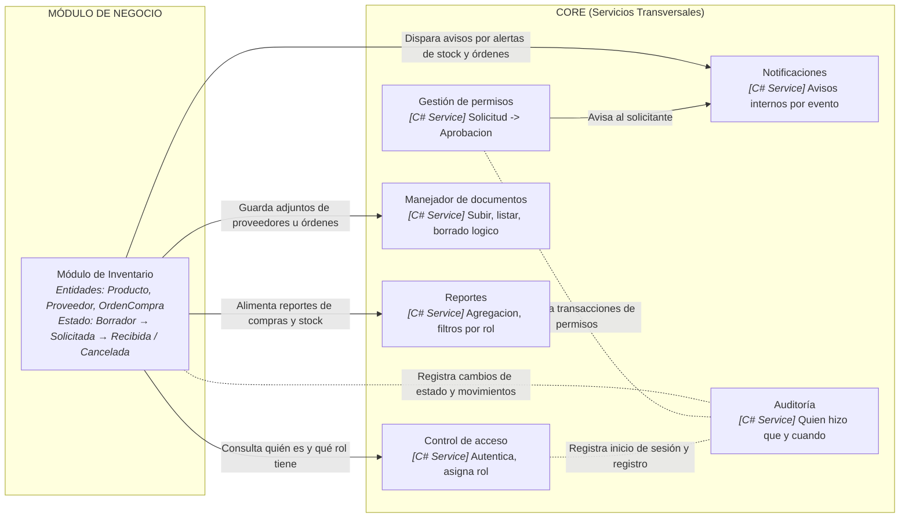

# ProyectoFinalProg3_Inventary
# Descripcion del proyecto
Este es el repositorio oficial del proyecto final de programación 3 basado en un sistema de inventario para un negocio pequeño desarrollado por Richard Hernández.

## Diagrama de componentes hecho en mermaid



### 4 Entidades base y relaciones
Cree las siguientes clases a continuacion:

1. **DetalleOrden** — Atributos: `Id`, `Cantidad`, `Precio`, `Subtotal`. Relaciones: `OrdenCompra` y `Producto`.
2. **OrdenCompra** — Atributos: `Id`, `FechaCreacion`, `Total`, `CreadoPorUsuarioId`, `ProveedorId`. Relaciones: `Proveedor` y `Detalles`.
3. **Producto** — Atributos: `Id`, `Nombre`, `Codigo`, `Precio`, `StockActual`, `StockMinimo`, `ProveedorId`. Relaciones: `Proveedor` y `DetallesOrden`.
4. **Proveedor** — Atributos: `Id`, `Nombre`, `Cedula`, `Telefono`, `Email`. Relaciones: `Productos` y `OrdenesCompra`.

#### Bitacora con el Agente - Punto 3
Crítica de la bitácora con el agente.

Le pedí que criticara el diagrama de componentes de acuerdo a las seis señales y me confirmó lo que supuse, la frontera de la dependencia Core- Negocio es unidireccional y correcta, pero me señaló que el componente Reportes no tenía conexiones en el diagrama visual, por lo que este agregó la relación de alimentación de reportes.

Error puntual que noté:
El agente me dio el diagrama corregido pero cometió un error, en la parte de los componentes del core no estaba el mensaje característico que decía de que se encargaba cada componente. tuve que corregirlo finalmente.

## Requisitos previos
- .NET SDK 10.0
- SQL Server (LocalDB o Express)
- Gmail con contraseña de aplicación (para el envío de correos)
- gitleaks (opcional, hook de seguridad): `winget install gitleaks.gitleaks`

## Variables de entorno
Ningún valor real debe guardarse en el repositorio; se inyectan por variables de entorno.

| Variable | Propósito | ¿Cuándo es obligatoria? |
|---|---|---|
| `ConnectionStrings__DefaultConnection` | Cadena de conexión a SQL Server | Siempre |
| `JwtSettings__SecretKey` | Clave de firma de los JWT (mín. 32 caracteres) | Siempre (la API no arranca sin ella) |
| `EmailSettings__SenderEmail` | Correo remitente (SMTP) | Para enviar correos reales |
| `EmailSettings__SenderPassword` | App Password de Gmail | Para enviar correos reales |
| `EmailSettings__UseSsl` | `true`/`false`; activa SSL del SMTP | Opcional (por defecto `true`) |

## Instrucciones de ejecución

1. Colocá las variables de entorno (ejemplo en PowerShell):
   ```powershell
   $env:JwtSettings__SecretKey = "una_clave_secreta_de_al_menos_32_caracteres_aqui"
   $env:EmailSettings__SenderEmail = "tucorreo@gmail.com"
   $env:EmailSettings__SenderPassword = "TU_APP_PASSWORD"

2. Aplica las migraciones y ejecuta la API web (no envía correos):

dotnet run --project ProyectoFinalProg3_Inventory/Presentation.API
Swagger: http://localhost:5176/swagger

3. Ejecuta el worker de correos en otro proceso (procesa la cola CorreosEnCola):

cd ProyectoFinalProg3_Inventory/EmailWorker
dotnet run
Ejecutá el worker desde su carpeta: dotnet run toma el directorio actual para leer appsettings.json.

### ¿Cómo crear un Administrador?
El registro crea usuarios con rol Estandar. Para el primer administrador, promové un usuario ya registrado en la BD:

UPDATE Usuarios SET Rol = 'Administrador' WHERE Email = 'tucorreo@gmail.com';
Luego volvé a hacer login para obtener un token con el rol incluido.

## Criterios implementados y cómo verificarlos

| Criterio | Endpoint / acción | Evidencia esperada |
|---|---|---|
| RF-CA-03 | `POST /api/Auth/Login` con usuario inexistente | Mensaje genérico, no revela si el correo existe |
| RF-CA-05/08 | `GET/PUT /api/admin/usuarios`, `PUT .../{id}/rol` con token Administrador | 200; con rol Estandar → 403 |
| RF-CA-09 | `POST /api/Auth/solicitar-recuperacion` | Respuesta genérica exista o no el correo |
| RF-CA-10/11/12 | `POST /api/Auth/restablecer-password` con código | Cambia la contraseña; invalida sesiones previas |
| RF-CA-13 | `POST /api/Auth/{id}/forzar-restablecimiento` (Administrador) | 200; sin rol Administrador → 401/403 |
| RF-CA-14 | `POST /api/Auth/registrar` con clave débil | 400 (política de contraseña) |
| RF-CA-18 | `POST /api/Auth/logout` y reusar el token | El token revocado es rechazado |
| RF-CA-19 | 5 logins fallidos seguidos | Bloqueo 15 min |
| RF-CA-20 | `PUT /api/admin/usuarios/{id}/estado` desactivar | Sesión abierta deja de ser válida; no se puede autodesactivar |
| RF-CA-22 | `POST /api/Auth/cambiar-password` con sesión | Cambia la clave y expira el token actual |
| RF-NEG-03/04/05 | Transiciones en `OrdenCompra` | Prohibidas lanzan error; `Recibida`/`Cancelada` son terminales |
| RD-04 | `Business.Inventory/Entities/OrdenCompra.cs` | Transiciones declaradas en un solo lugar |
| RD-06 | `[Authorize(Roles = "Administrador")]` en acciones destructivas | 403 sin el rol |


### Corrección Puntual aplicada - Problema de Credencial filtrada:

El Problema puntual identificado por el maestro cuando realizó la corrección de la práctica 1 fue resuelto, el problema era el siguiente: En el historial de commits había datos de una credencial de Gmail visible que no debía estar ahí. Finalmente, este error fue corregido.

