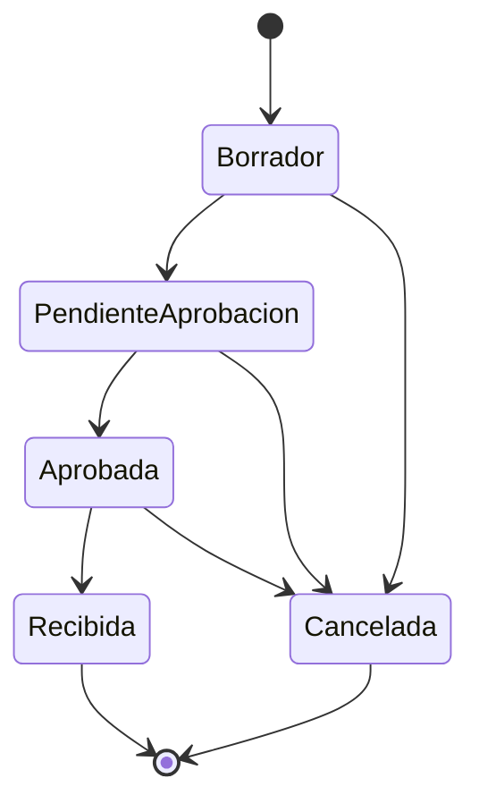

# Máquina de Estados - OrdenCompra

Documento que describe la máquina de estados de la entidad central de negocio **`OrdenCompra`** (RF-NEG-03, RD-04, RF-NEG-04, RF-NEG-05, RF-NEG-09).

## Estado actual de la entidad

La entidad `OrdenCompra` (proyecto `Business.Inventory`) expone el atributo `Estado` de tipo `EstadoOrden`, cuyo `set` es privado. Todo cambio de estado pasa obligatoriamente por los métodos de negocio definidos en la propia entidad (`EnviarAAprobacion`, `Aprobar`, `Recibir`, `Cancelar`), los cuales validan la transición contra un único mapa de transiciones permitidas declarado en un solo lugar (`TransicionesPermitidas`).

- **Entidad:** `Business.Inventory.Entities.OrdenCompra`
- **Enum de estados:** `Core.Domain.Entities.Enums.EstadoOrden`
- **Lugar único de las transiciones:** `OrdenCompra.TransicionesPermitidas` (RD-04)

## Estados declarados (RF-NEG-03)

| # | Estado | Descripción | Tipo |
| :---: | :--- | :--- | :--- |
| 1 | `Borrador` | La orden se está construyendo; aún puede editarse. | Activo |
| 2 | `PendienteAprobacion` | La orden fue enviada y espera decisión del administrador. | Activo |
| 3 | `Aprobada` | La orden fue aprobada y puede recibirse. | Activo |
| 4 | `Recibida` | El inventario llegó y se registró. | **Terminal** (RF-NEG-05) |
| 5 | `Cancelada` | La orden se canceló; no puede cambiar de estado. | **Terminal** (RF-NEG-05) |

## Métodos de la entidad y su transición

| Método | Transición que ejecuta | Notas |
| :--- | :--- | :--- |
| `EnviarAAprobacion()` | `Borrador` → `PendienteAprobacion` | Delegado a `CambiarEstado(EstadoOrden.PendienteAprobacion)`. |
| `Aprobar()` | `PendienteAprobacion` → `Aprobada` | Delegado a `CambiarEstado(EstadoOrden.Aprobada)`. |
| `Recibir()` | `Aprobada` → `Recibida` | Delegado a `CambiarEstado(EstadoOrden.Recibida)`. |
| `Cancelar()` | Desde estados permitidos → `Cancelada` | Delegado a `CambiarEstado(EstadoOrden.Cancelada)`. |

## Tabla de transiciones permitidas (RD-04)

| Desde | Hacia | Quién la ejecuta | Condición |
| :--- | :--- | :--- | :--- |
| `Borrador` | `PendienteAprobacion` | Estándar / Administrador (quien crea la orden) | La orden tiene al menos un detalle y un proveedor asignado, y el usuario la envía. |
| `Borrador` | `Cancelada` | Estándar / Administrador | El creador desiste o el administrador descarta la orden en borrador. |
| `PendienteAprobacion` | `Aprobada` | **Administrador** | El administrador evalúa el presupuesto y aprueba la orden. |
| `PendienteAprobacion` | `Cancelada` | **Administrador** | El administrador rechaza o cancela la orden. |
| `Aprobada` | `Recibida` | Estándar / Administrador | El inventario llega físicamente y se registra la recepción en el almacén. **Requiere tener el permiso `recibir-orden` concedido por Gestión de Permisos (aprobado en `SolicitudPermiso`) y registrado en `PermisosUsuario`.** |
| `Aprobada` | `Cancelada` | **Administrador** | El proveedor informa que no puede despachar la orden. |
| `Recibida` | *(ninguna)* | — | Estado terminal: no admite transiciones de salida (RF-NEG-05). |
| `Cancelada` | *(ninguna)* | — | Estado terminal: no admite transiciones de salida (RF-NEG-05). |

## Regla de validación (RD-07)

Toda transición se resuelve **exclusivamente** en `OrdenCompra.CambiarEstado(EstadoOrden nuevoEstado)`.

- Si `nuevoEstado` **no** se encuentra en `TransicionesPermitidas[EstadoActual]`, se lanza `InvalidOperationException` con el mensaje `Transición inválida: No se puede cambiar el estado de {Estado} a {nuevoEstado}.`
- **El estado de la entidad no se modifica** cuando la transición es inválida.
- Los estados `Recibida` y `Cancelada` son terminales: al no tener salidas en el mapa, **cualquier intento de transición desde ellos es rechazado**.

## Tabla de transiciones prohibidas explícitas (RF-NEG-04)

Estas son las transiciones que no están declaradas en `TransicionesPermitidas` y deben ser rechazadas de forma controlada.

| Desde | Hacia | Razón | Comportamiento esperado |
| :--- | :--- | :--- | :--- |
| `Borrador` | `Aprobada` | Salto de estado. Debe pasar obligatoriamente por `PendienteAprobacion`. | `InvalidOperationException`. El estado permanece en `Borrador`. |
| `Borrador` | `Recibida` | Salto de estado. Debe pasar por `PendienteAprobacion` y `Aprobada`. | `InvalidOperationException`. El estado permanece en `Borrador`. |
| `PendienteAprobacion` | `Recibida` | Salto de estado. Debe pasar obligatoriamente por `Aprobada`. | `InvalidOperationException`. El estado permanece en `PendienteAprobacion`. |
| `PendienteAprobacion` | `PendienteAprobacion` | No hay auto-transición declarada. | `InvalidOperationException`. El estado permanece en `PendienteAprobacion`. |
| `Aprobada` | `Aprobada` | No hay auto-transición declarada: una orden ya aprobada no se vuelve a aprobar. | `InvalidOperationException`. El estado permanece en `Aprobada`. |
| `Aprobada` | `PendienteAprobacion` | Retroceso no permitido. Una orden aprobada no vuelve a espera. | `InvalidOperationException`. El estado permanece en `Aprobada`. |
| `Recibida` | `Borrador` / `PendienteAprobacion` / `Aprobada` / `Cancelada` / `Recibida` | **Estado terminal.** No admite transiciones de salida (RF-NEG-05). | `InvalidOperationException`. El estado permanece en `Recibida`. |
| `Cancelada` | `Borrador` / `PendienteAprobacion` / `Aprobada` / `Recibida` / `Cancelada` | **Estado terminal.** No admite transiciones de salida (RF-NEG-05). | `InvalidOperationException`. El estado permanece en `Cancelada`. |

## Diagrama

